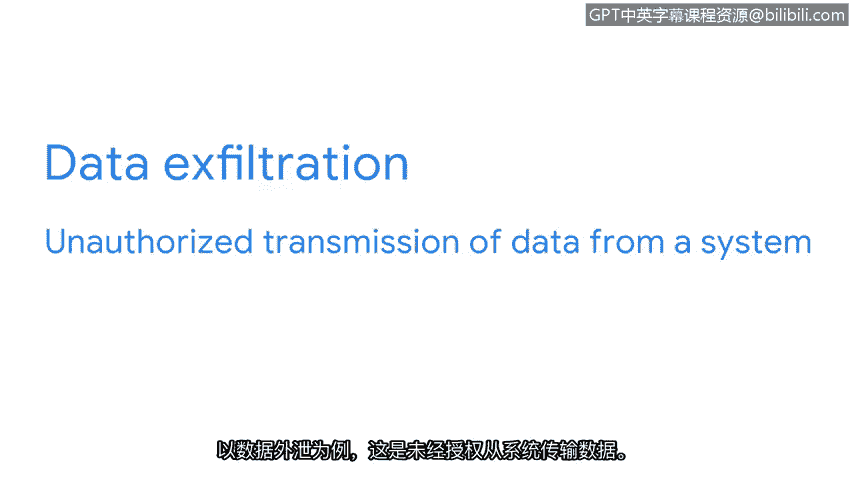

# 谷歌网络安全专业证书第六课：《拉响警报：检测与响应》（中英字幕，前面分p中字，后面分p英字） - P15：14_网络流量流动的重要性.zh - GPT中英字幕课程资源 - BV1eV41157nD

In many organizations， network communication travels over multiple networks in different countries and across different devices。

 Data can get unintentionally sent and stored in insecure places like personal email inbox or cloud storage platforms。

Users trust that their data is safely and securely sent and stored。

 and it's the job of security professionals like you to help protect these communications in transit and at rest。

Previously， you may recall learning how to identify and secure critical assets through security controls like data classification and encryption Com up we'll expand on this topic and examine how network traffic analysis can be used to monitor network activity and identify potential malicious activity。

So what is network traffic？Network traffic is the amount of data that moves across a network。

 While network data is the data that's transmitted between devices on a network。

Depending on the size of a network， there can be a huge volume of network traffic at any given moment。

 For example， in a large multinational organization。

 there may be thousands of employees sending and receiving emails at any given time。

 That's a lot of network traffic， with such large volumes of traffic being produced。

 How do you know what's normal behavior or what's unusual and requires investigation as a potential security incident。

Imagine being stuck in unexpected traffic during your regular drive to work。 And as you move along。

 you realize something unusual caused the traffic like a minor vehicle collision。

 which slowed down the expected flow On the road， we have certain expectations about traffic flows based on our commuting experience。

😊，Peak traffic patterns like morning and evening rush are normal and expected。

 While abnormal traffic during off peak times reveals that something unexpected has happened like a vehicle collision。

Network traffic works in the same way by understanding how data should be flowing across the network。

 you can develop an understanding of expected network traffic flow By knowing what's normal。

 you can easily spot what's abnormal。We can detect traffic abnormalities through observation to spot indicators of compromise。

 also known as I O C， which are observable evidence that suggests signs of a potential security incident。

Take， for instance， data X filtration， which is the unauthorized transmission of data from a system。

Attackers use data X filtration to steal or leak data， such as username。

 passwords or intellectual property。 by observing network traffic。

 we can determine if there's any indicators of compromise such as large volumes of outbound traffic。

 leaving a host。 This is a sign of possible data exfililtration， which can be further investigated。

Understanding and monitoring network traffic for inconsistencies is an important aspect of a security professional's job Com up we'll explore what a data exfiltration attack looks like in real time。

 meet you there。