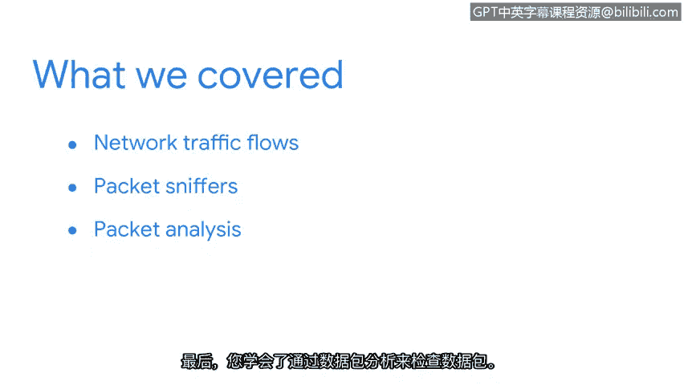

# 谷歌网络安全专业证书第六课：《拉响警报：检测与响应》（中英字幕，前面分p中字，后面分p英字） - P21：20_总结.zh - GPT中英字幕课程资源 - BV1eV41157nD

Nice work so far。 Congratulations on capturing and analyzing your first packet。

 Let's review what we've covered so far。 First， you learned how network traffic flows provide valuable communications insight。

 through monitoring network activity for indicators of compromise。

 You learn how to spot unusual network activity like data Xfililtration。

 Then you learn how to view and capture network traffic using packet sniffs。 Finally。

 you learned how to inspect packets through packet analysis。

 You dissected packet header data fields and analyze packet captures in detail。

 You've made a lot of progress in developing the skills you'll need to prepare for an entry levelve role and security。

 Com up， you'll be immersed into the exciting world of incident investigation where you'll examine the processes behind detecting and containing an incident。

 I'll meet you there。😊。

