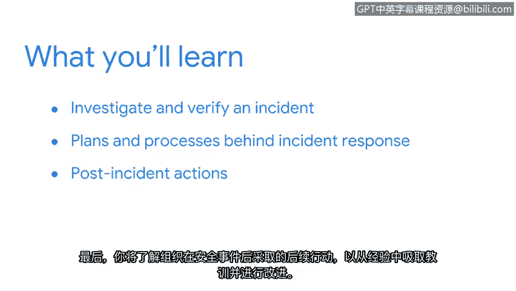

# 谷歌网络安全专业证书第六课：《拉响警报：检测与响应》（中英字幕，前面分p中字，后面分p英字） - P22：21_欢迎来到第三周.zh - GPT中英字幕课程资源 - BV1eV41157nD

Welcome back。 I want to commend you on such a fantastic job you're doing so far。

 The skills you are learning will create a solid foundation as you begin your security career。

 In the previous section， you applied your networking knowledge to deepen your understanding of network traffic。

 You practice some skills that security analysts use on the job like capturing network traffic and dissecting packets。

 Next， will examine the life cycle of a security incident from beginning to end。

 You'll focus on how to detect， respond and recover from an incident。😊，Coming up。

 you'll learn how to investigate and verify an incident once it's been detected。

 You'll explore the plans and processes behind incident response。 Finally。

 you'll learn about the post incident actions that organizations take to learn and improve from the experience。

 At the end of this section， you'll gain a comprehensive understanding of an incident's life cycle。

 You're ready。 Let's begin。

