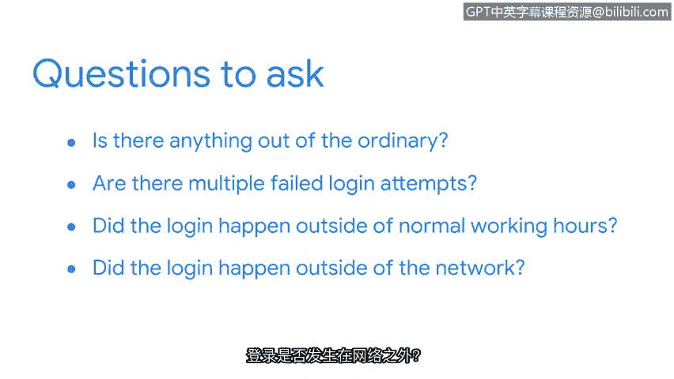

# 谷歌网络安全专业证书第六课：《拉响警报：检测与响应》（中英字幕，前面分p中字，后面分p英字） - P28：27_事故处理中的初步审查的作用.zh - GPT中英字幕课程资源 - BV1eV41157nD

As you've learned， security analysts can be flooded with a large amount of alerts on any given day。

 How does an analyst manage all these alerts。Hospital emergency departments receive a large number of patients every day。

 and each patient needs medical care for a different reason。

 but not all patients will receive medical care immediately。

 This is because hospitals have a limited number of resources available and must manage their time and energy efficiently。

 They do this through a process known as triage。In medicine。

 triage is used to categorize patients based on the urgency of their conditions。 For example。

 patients with a life threatening condition such as a heart attack will receive immediate medical attention。

 but a patient with a non life threatening condition like a broken finger may have to wait before they see a doctor。

Triage helps to manage limited resources so that hospital staff can give immediate attention to patients with the most urgent conditions。

Triage is also used in security。 Before an alert gets escalated。

 it goes through a triage process which prioritizes incidents according to their level of importance or urgency。

 Similar to hospital emergency departments， security teams have limited resources available to dedicate to incident response。

Not all incidents are the same， and some may involve an urgent response。

Incidents are triaged according to the threat they pose to the confidentiality。

 integrity and availability of systems。For example。

 an incident involving ransomware requires immediate response。

 This is because ransomware may cause financial， reputational and operational damage。

 Rasomware is a higher priority than an incident like an employee receiving a phishing email。

When does triage happen， once an incident is detected and an alert gets sent out， triage begins。

As a security analyst， you'll identify the different types of alerts and then prioritize them according to urgency。

The triage process generally looks like this。 First。

 you'll receive and assess the alert to determine if it's a false positive and whether it's related to an existing incident。

If it's a true positive， you'll assign priority on the alert based on the organization's policy and guidelines。

The priority level defines how the organization's security team will respond to the incident。

 Finally， you'll investigate the alert and collect and analyze any evidence associated with the alert。

 such as system logs。As an analyst， you'll want to ensure that you complete a thorough analysis so that you have enough information to make an informed decision about your findings。

For example， say that you receive an alert for a failed user login attempt。

You'll need to add context to your investigation to determine if it's malicious。

 You can do so by asking questions。 Is there anything out of the ordinary associated with this alert。

 Are there multiple failed login attempts。 Did the login happen outside of normal working hours。

 Did the login happen outside of the network。

These questions paint a picture around the incident。

 by adding context you avoid making assumptions which can result in incomplete or incorrect conclusions。

Now that we've covered how to triage alerts， we're ready to discuss how to respond and recover from an incident。

 let's go。

