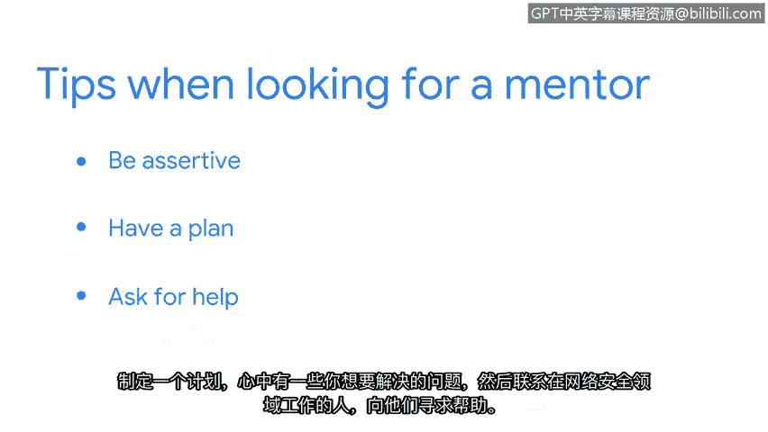

# 谷歌网络安全专业证书第六课：《拉响警报：检测与响应》（中英字幕，前面分p中字，后面分p英字） - P2：1_戴夫：通过导师培养网络安全职业.zh - GPT中英字幕课程资源 - BV1eV41157nD

My name is Dave， I'm a principal security strategist with Google Cloud。

 my job is to work directly with security practitioners to help them protect their organizations。

What I love about my job is the variety On one day I might be troubleshooting a technical problem for a customer。

 the next day I might be coding up a solution to a certain problem every day is something new。

 and I never get bored。 I was a kid growing up in the Midwest。

 I went off to college to study engineering。 I thought but I realized that I wasn't really into engineering。

 but I loved computer science， which I didn't even know was an option。

 I ended up working as a help deskk person early in college。

 but then I got a job as a system administrator。 I found myself working at a startup in the payments industry。

 my job switched from being a general IT person to being a cybersecurity person。

 I spent seven years on that job and did everything from a one man security shop to running mediumsd security organization toward the end。

 then I switched over to the other side of the table and started working for。Security vendors and。

That gave me the opportunity to see how literally hundreds of other organizations run their security programs and that was really eye opening Cybersecurity is interesting because you can really bring your entire life experience to cybersecurity。

What you're doing is trying to protect an organization， not necessarily like from an accident。

 but you're protecting an organization from a human being on the other side who's trying to do your organization harm。

 One thing that's becoming clear is that people from diverse backgrounds and diverse experiences typically bring a great deal of improvement to how we deal with that。

 I highly recommend getting involved with security organizations。

 It's a place to meet other people who can help you along in your career。

 I think people are surprised to learn just how much help is available in our industry。

 There are lots of folks who are more senior and more accomplished who are willing to be mentors I think the best thing that you can do as someone who's looking for a mentor is to be assertive have a plan So have a few things in mind that you want to work on。

 I then reach out to someone who maybe works in that particular。

AreaOf cybersecurity and ask them for help。 And I think you'll be surprised at just how helpful folks will be。

