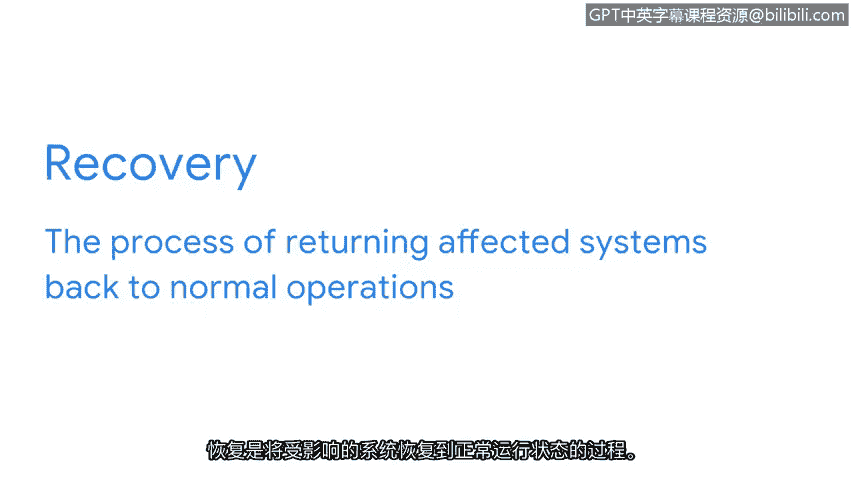

# 谷歌网络安全专业证书第六课：《拉响警报：检测与响应》（中英字幕，前面分p中字，后面分p英字） - P30：29_生命周期的封锁、清除和恢复阶段.zh - GPT中英字幕课程资源 - BV1eV41157nD

In this video， we'll discuss the third phase of the incident response life cycle。

 This phase includes the steps for how security teams contain。

 eradicate and recover from an incident。It's important to note that these steps interrelate。

 Containment helps meet the goals of eradication， which helps meet the goals of recovery。

This phase of the life cycle also integrates with the core functions of the NIST cybersecurity framework。

 respond and recover。Let's begin with the first step， containment。

After an incident has been detected， it must be contained。

 Containment is the act of limiting and preventing additional damage caused by an incident。

Organizations outlined their containment strategies and incident response plans。

Containment strategies detail the actions that security teams should take after an incident has been detected。

 Different containment strategies are used for various incident types。For example。

 a common containment strategy for a malware incident on a single computer system is to isolate the affected system by disconnecting it from the network。

This prevents the spread of the malware to other systems in the network。As a result。

 the incident is contained to the single compromised system， which limits any further damage。

 Containment actions are the first step toward removing a threat from an environment。

Once an incident has been contained， security teams work to remove all traces of the incident through eradication。

 Erdication involves the complete removal of the incident elements from all affected systems。

 For example， eradication actions include performing vulnerability tests and applying patches to vulnerabilities related to the threat。

Finally， the last step of this phase in the incident response life cycle is recovery recovery is the process of returning affected systems back to normal operations。

An incident can disrupt key business operations and services during recovery。

 Any services that were impacted by the incident are brought back to normal operation。

Recovery actions include reimaging affected systems， resetting passwords。

 and adjusting network configurations like firewall rules。Remember。

 the incident response lifecycl is cyclical， multiple incidents can happen across time。

 and these incidents can be related。 Security teams may have to circle back to other phases in the life cycle to conduct additional investigations。

Next up， we'll discuss the final phase of the life cycle， Meet you there。

