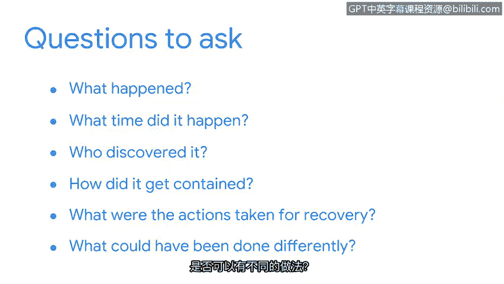

# 谷歌网络安全专业证书第六课：《拉响警报：检测与响应》（中英字幕，前面分p中字，后面分p英字） - P31：30_生命周期的事后活动阶段.zh - GPT中英字幕课程资源 - BV1eV41157nD

Now that a security team has successfully contained， eradicated and recovered from an incident。

 their job is done， right， Not quite。 Whether it's a new technology or a new vulnerability。

 There's always more to learn in the security field。

 The perfect time for learning and improvement happens during the final phase of the incident response life cycle。

 post incident activity。😊，The post incident activity phase entails the process of reviewing an incident to identify areas for improvement during incident handling。

During this phase of the life cycle， different types of documentation get updated or created。

 One of the critical forms of documentation that gets created is the final report。

 The final report is documentation that provides a comprehensive review of an incident。

 It includes a timeline and details of all events related to the incident and recommendations for future prevention。

During an incident， the goal of the security team is to focus efforts on response and recovery。

 After an incident， security teams work to minimize the risk of it happening again。

 One way to improve processes is to hold a lessons learned meeting。

 A lessons learned meeting includes all parties involved in the incident and is generally held within two weeks after the incident during this meeting。

 The incident is reviewed to determine what happened What actions were taken and how well the actions worked。

The final report is also used as the main reference document during this meeting。

The goal of the discussions in a lessons learned meeting is to share ideas and information about the incident and how to improve future response efforts。

Here are some questions to ask during a lessons learned meeting。 What happened。

What time did it happen。Who discovered it？How did it get contained。

What were the actions taken for recovery？What could have been done differently？

Incident reviews can reveal human errors before detection and during response。

 whether it's a security analyst missing a step in a recovery process or an employee clicking a link in a phishing email。

 resulting in the spread of malware。Blaming someone for an action they did or didn't do should be avoided。

 Instead， security teams can view this as an opportunity to learn from what happened and improve。

