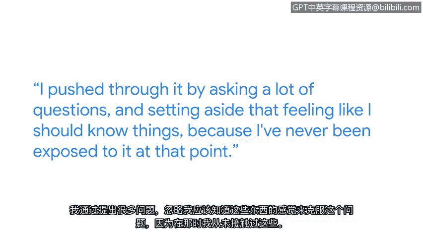

# 谷歌网络安全专业证书第六课：《拉响警报：检测与响应》（中英字幕，前面分p中字，后面分p英字） - P35：34_丽贝卡：学习新的工具和技术.zh - GPT中英字幕课程资源 - BV1eV41157nD

。

I'm Rebecca， I am a security engineer at Google and I focus in identity management。

The best part of the job is probably thinking like an attacker。 I love that part of seeing like。

 how can I break stuff， seeing a system and figure out how can I get into it If I was a bad guy。

 what would I be wanting， What would I be looking for， How would I find the credentials。 How would I。

 you know， find the machine that's useful and get onto it， My first day in security。

 We were learning a new tool， Like the whole。😊，Organization was into training and they're like。

 we're going to throw you in， it's a one week training to learn a network analyzer。

I didn't know anything about networks， let alone network security or what this thing was gonna be used for。

 And so I was very overwhelmed because I felt like I was impostor sitting in somebody's seat who should belong there。

 and learning stuff way over my head。 I pushed her by asking a lot of questions and setting aside that feeling like I should know things because I've never been exposed to it at that point。

 The only way I'm gonna to know is if I ask。 So this course has a lot of tools and covers a lot of information and it can be very easy to be overwhelmed。

 In fact， I probably would be as well。 there's a lot of information that you can take in。

 I think of learning in a course like this where there' there's a series of courses for you to learn。

 that it's like a climbing a mountain。 you've gotten so far up the mountain and the air gets thin。

 and yes， it is difficult。 you feel overwhelmed but you're almost to the top。😊。

now that when you get to the top， you're going to have an amazing view of the world and that's the same thing of when you finish these courses。

 your frame of mind and how you view things and your capabilities。

 your potential for finding new jobs or changing careers is that much better。

