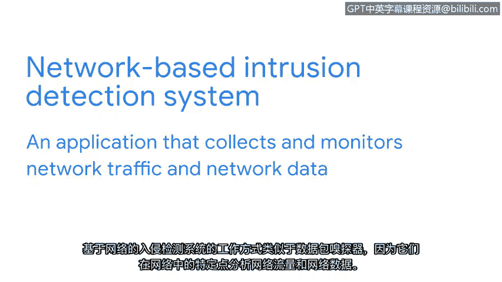

# 谷歌网络安全专业证书第六课：《拉响警报：检测与响应》（中英字幕，前面分p中字，后面分p英字） - P37：36_使用检测工具进行安全监控.zh - GPT中英字幕课程资源 - BV1eV41157nD

Detection requires data， and this data can come from various data sources。

 You've already explored how different devices produce logs。 Now。

 we'll examine how different detection technologies monitor devices and log different types of system activity like network and endpoint telemetry。

Telemetry is the collection and transmission of data for analysis。

 while logs record events occurring on systems， telemetry describes the data itself， for example。

 packetca captures are considered network telemetry。For security professionals。

 logs and telemetry are sources of evidence that can be used to answer questions during investigations。

Previously， you learned about an intrusion detection system or IDS。

 remember that IDS is an application that monitors activity and alerts on possible intrusions。

This includes monitoring different parts of a system or network， like an endpoint。

An endpoint is any device connected on a network such as a laptop， tablet。

 desktop computer or a smartphone。 Endpoints are entry points into a network。

 which makes them key targets for malicious actors looking to gain unauthorized access into a system。

To monitor endpoints for threats or attacks， a host based intrusion detection system can be used。

 It's an application that monitors the activity of the host on which it's installed to clarify a host is any device that communicates with other devices on a network。

 similar to an endpoint。Host based intrusion detection systems are installed as an agent on a single host。

 such as a laptop computer or a server。 Depend on its configuration。

 host based intrusion detection systems will monitor the host on which it's installed to detect suspicious activity。

Once something's been detected， it records output as logs and an alert gets generated。

What if we wanted to monitor a network。A network based intrusion detection system collects and analyzes network traffic and network data。

 Network based intrusion detection systems work similar to packet sniffs because they analyze network traffic and network data on a specific point in the network。

It's common to deploy multiple I D S sensors at different points in the network to achieve adequate visibility。

 When suspicious or unusual network activity is detected。

 the network based intrusion detection system logs it and generates an alert。 In this example。

 the network based intrusion detection system is monitoring the traffic that's both coming from and going to the Internet。

Intrusion detection systems use different types of detection methods。

 One of the most common methods is signature analysis。

Signature analysis is a detection method used to find events of interest。

 A signature specifies a set of rules that an I D S refers to when it monitors activity。

 If the activity matches the rules in the signature， the I D S logs it and sends out an alert。

 For example， a signature can be written to generate an alert。

 If a failed login on a system happens three times in a row。

 which suggests a possible password attack。Before alerts are generated， the activity must be logged。

 IS technologies record the information of the devices。

 systems and networks which they monitor as IDS logs。I D S logs can then be sent。

 stored and analyzed in a centralized log repository， like a Sim。Coming up。

 we'll explore how to read and configure signatures。 We'll meet you there。

