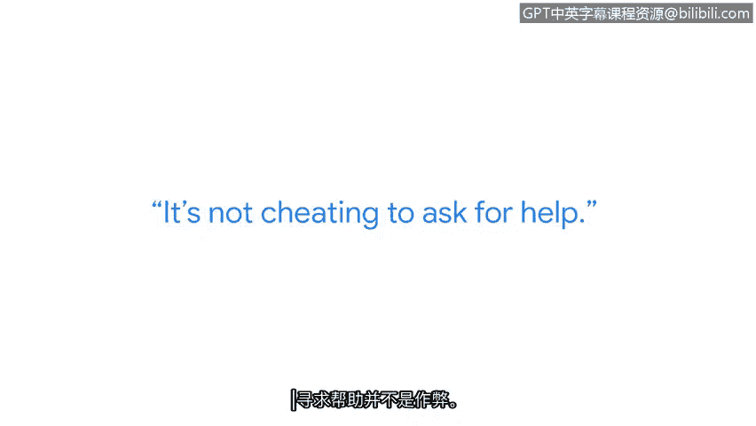

# 谷歌网络安全专业证书第六课：《拉响警报：检测与响应》（中英字幕，前面分p中字，后面分p英字） - P38：37_格雷斯：检测和响应中的安全思维.zh - GPT中英字幕课程资源 - BV1eV41157nD

Hi， I'm Grace， and I work in detection responsespon at Google When I tell people what I do。

 they think is's awesome， you know， like I love being able to say my job is to detect hackers trying to hack Google。

 There are people who trust us with their data that play critical roles in society like journalists and activists。

 for example， So they need to be able to have their data with us and trust that it's going be safe Security mindset is。

😊，About curiosity， There's a really nice overlap between cyber security and computers and having that creative and logical outlet and an interest in big world matters。

 What hackers are thinking， what defenders are thinking。 I'm empathizing with people。

 looking at how information can be obtained。😊，Perhaps sometimes from unusual sources。

 an example of one of the craziest things that I've learned about would be how people can get information from a CPU。

 Some tasks for a CPU more difficult than others require more energy to do。

 Multiplying numbers is an example of that， which means that the CPU is going to like work harder。

 It's going to get hotter。 It's going to like。Be executing more functions so you can use that information to know things about what that CPU is doing from there。

 you can start to deduce what's happening at a given point in time。

 What I recommend to people who are interested in developing a security mindset。

 is listen to stories。 There are podcasts that have great interviews with hackers。

 I recommend following the news and reading news articles about different cyber threats that are happening on in the world。

 I recommend going to conferences， go to meetups， finding people that you can study with and practice with。

 Even hackers are teaching each other， how to hack things in forums and chat rooms。

 It's not cheating to ask for help。😊。

Another piece of advice that I have for people would be to not give up when you have Robbs。

 Stying the certificate is a really good idea， and it's really worth persevering right to the very end。

 Even when it gets hard and you start feeling overwhelmed。 That's okay。 The new terms。

 I can guarantee that if you come back to it later， you'll be more familiar your find it easier。

 Being really gentle with yourself and understanding and patient will help a lot when you're facing these challenges。

😊。