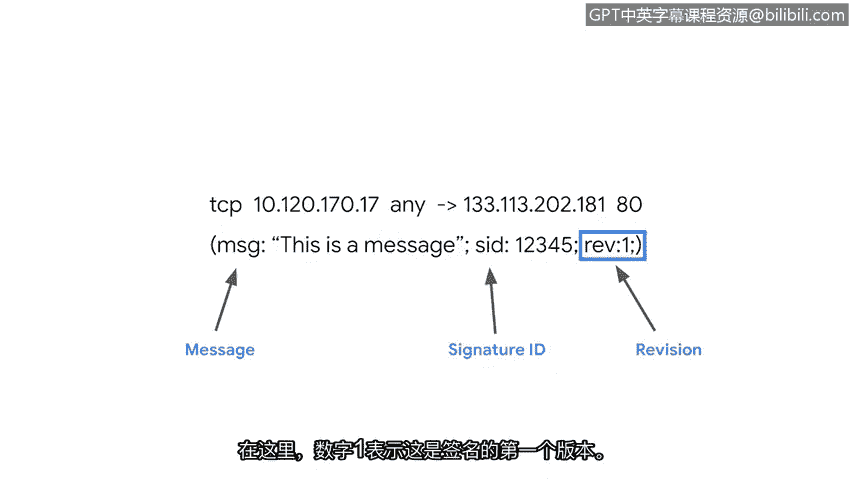
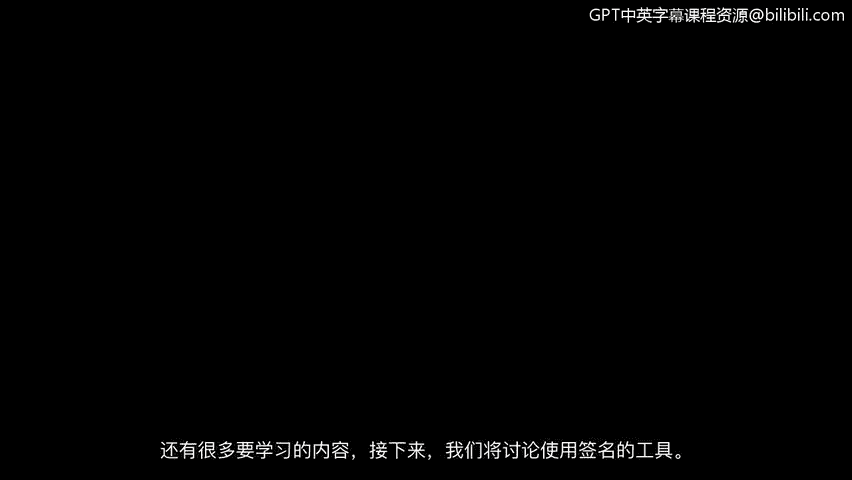

# 谷歌网络安全专业证书第六课：《拉响警报：检测与响应》（中英字幕，前面分p中字，后面分p英字） - P39：38_检测签名的组成部分.zh - GPT中英字幕课程资源 - BV1eV41157nD

As a security analyst， you may be tasked with writing， customizing or testing signatures to do this。

 you'll use I D S tools。 So in this section， we'll examine signature syntax。 And by the end。

 you'll be able to read a signature。A signature specifies detection rules。

 These rules outline the types of network intrusions you want an I D S to detect。 For example。

 a signature can be written to detect and alert on suspicious traffic。

 attempting to connect to a port。Rule language differs depending on different network intrusion detection systems。

 The term network intrusion detection system is often abbreviated as the acronym N I D S and pronounced Nds。

Generally， NID's rules consist of three components， an action， a header and rule options。Now。

 let's examine each of these three components in more detail。Typically。

 the action is the first item specified in a signature。

 This determines the action to take if the rule criteria matches are met。

Actions differ across NID's rule languages， but some common actions are alert， pass or reject。

Using our example， if a rule specifies to alert on suspicious network traffic that establishes an unusual connection to a port。

 the IDS will inspect the traffic packets and send out an alert。

The header defines the signature's network traffic。

 These include information such as source and destination I P addresses。

 source and destination ports， protocols and traffic direction。

If we want to detect and alert on suspicious traffic connecting to a port。

 we have to first define the source of the suspicious traffic in the header。

 Supicious traffic can originate from I P addresses outside the local network。

 It can also use specific or unusual protocols。 It can specify external I P addresses and these protocols in the header。

Here's an example of how header information may appear in a basic rule。 First。

 we can observe that the protocol TC P is the first listed item in the signature。Next。

 the source I P address 10 dot 120 dot 1，70 do 17。 and the source port number is specified as being any。

The arrow in the middle of the signature indicates the direction of the network traffic。

 So we know it's originating from the source I P 10 dot 120 dot 170 do 17 from any port going to the following destination I P address 133t 1。

13 dot 202 dot 181 and destination port 80。The rule options let you customize signatures with additional parameters。

There are many different options available to use。 For instance。

 you can set options to match the content of a network packet to detect malicious payloads。

Micious payloads reside in a packet's data and perform malicious activity like deleting or encrypting data。

Configuring rule options helps in narrowing down network traffic so you can find exactly what you're looking for。

 Typ rule options are separated by semicolonons and enclosed in parentheses In this example。

 we can examine that the rule options are enclosed in a pair of parentheses and are also separated with semicolonons。

The first rule option， M S G， which stands for message， provides the alerts text。 In this case。

 the alert will print out the text。 This is a message。 There's also the option S I D。

 which stands for Sign I D。 This attaches a unique I D to each signature。

The revv option stands for revision。 Each time a signature is updated or changed。

 the revision number changes here。 the number one means it's the first version of the signature。

Great， now you've developed another skill in your journey towards becoming a security analyst。

How to read signatures。 There's so much more to learn。 And coming up。

 we'll discuss tools that use signatures。

