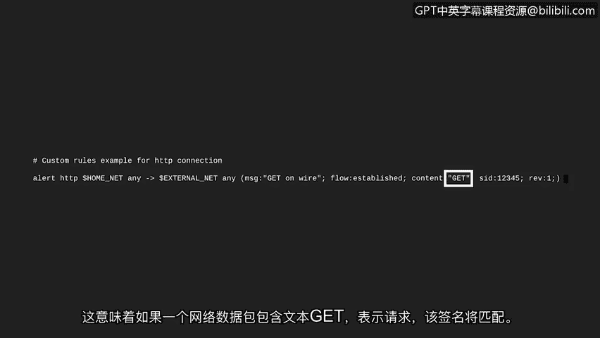
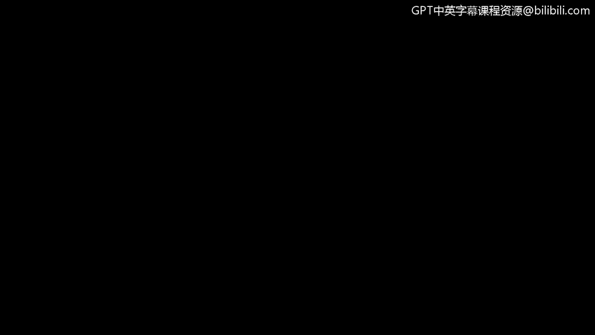

# 谷歌网络安全专业证书第六课：《拉响警报：检测与响应》（中英字幕，前面分p中字，后面分p英字） - P40：39_使用Suricata检查签名.zh - GPT中英字幕课程资源 - BV1eV41157nD

Previously， you learned about signature based analysis。

 You also learned how to read signatures used in network based intrusion detection systems。

Here we'll use an open source signature based IS called Scottta to examine a signature。

Many MIIDs technologies come with prewritten signatures。

 and you can think of these signatures as customizable templates。

 sort of like different templates available in a word processor。

These signature templates provide you with a starting point for writing and defining your rules。

 You can also write and add your own rules。 Let's examine a prewritten signature through Surracottta。

On this Linux machine running Uuntu， Surracottta is already installed。

 Let's examine some of its files by changing directories to the Etsy directory and into the Surracottta directory。

 This is where all of Sararakata's configuration files live。Next。

 we'll use the LS command to list the contents of the Surrocottta directory。

There's a couple of different files in here， but we'll focus on the rules folder。

 This is where the prewritten signatures are。 You can also add custom signatures here。

 We'll use the C D command， followed by the name of the folder to navigate to that folder using the L S command。

 We can observe that the folder contains some rule templates for different protocols and services。

 Let's examine the custom do rules file using the less command。As a quick refresher。

 the less command returns the content of a file one page at a time。

 which makes it easy to move forward and backward through the content。

We'll use the arrow key to scroll up。Lines that begin with a pound sign are comments meant to provide context for those who read them and are ignored by Surracottta。

The first line says custom rules example for H TTP connection。

This tells us that this file contains custom rules for HTTP connections。

We can observe that there's a signature。 The first word specifies the signature's action For this signature。

 the action is alert。 This means that the signature generates an alert when all of the conditions are met。

The next part of the signature is the header。 It specifies the protocol H T TP。

 The source I P addresses homenet， and the source port is defined as any。

The arrow indicates the direction of traffic coming from the home network and going to the destination I P address。

 external net and any destination port。So far， we know that this signature triggers an alert when it detects any HTTP traffic leaving the home network and going to the external network。

Let's examine the remainder of the signature to identify if there's any additional conditions the signature looks for。

The last part of the signature includes the rule options。

 They're enclosed in parentheses and separated by semicoons。 There's many options listed here。

 but we'll focus on the message， flow and content options。

The message option will show the message get on wire once the alert is triggered。

The flow option is used to match on direction of network traffic flow。 Here， it's established。

 This means that a connection has been successfully made。

The content option inspects the content of a packet here between the quotation marks。

 the text get is specified。 Get is an H T TP request that's used to retrieve and request data from a server。

 This means the signature will match if a network packet contains the text get， indicating a request。

To summarize， this signature alerts anytime Serrakata observes the text get in an HTTP connection from the home network going to the external network。

 Every environment is different and in order for an IDS to be effective。

 signatures must be tested and tailored as a security analyst， you may test。

 modify or create IDS signatures to improve the detection of threats in an environment and reduce the likelihood of false positives。

Coming up， we'll examine how Surracottta logs events Me you there。

