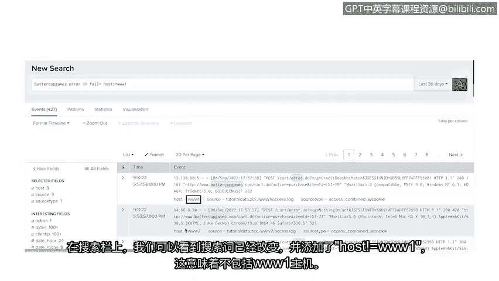

# 谷歌网络安全专业证书第六课：《拉响警报：检测与响应》（中英字幕，前面分p中字，后面分p英字） - P43：42_使用Splunk查询事件.zh - GPT中英字幕课程资源 - BV1eV41157nD

Now that we've reviewed how a SM works， let's learn how to search and query events in a SIM database data that's been imported into a SIM can be accessed by entering queries into the Sims search engine。

 Maive amounts of data can be stored in a SM database。 Some of this data may date back years。

This can make searching for security events challenging。 For example。

 let's say you're searching to find a failed login event。

 You search for the event using the keywords failed login。This is a very broad query。

 which can return thousands of results。 Broad search queries like this slow down the response times of a search engine since it's searching across all the index data。

 But if you specify additional parameters like an event I D and a date and time range。

 you can narrow down the search to get faster results。

 It's important that search queries are specific so that you can find exactly what you're looking for and save time in the search process。

 Different Sim tools use different search methods。For example。

 Splunk uses its own query language called search processing language or SL for short。

SPL has many different search options you can use to optimize search results so that you can get the data you're looking for For now I'll demonstrate a raw log search in Splunk cloud for events that reference errors or failures for a fictional online store called Buttercup Games。

First， we'll use the search bar to type in our query， Buttercup Game， erroror or Fail star。

This search is specifying the index， which is Buttercup games。

 We also specify the search terms error or fail。 The Boolean operator or ensures that both of the keywords will be searched。

The asterisk at the end of the term fail star is known as a wild card。

 This means it will search for all possible endings that contain the term fail。

 This helps us expand our search results because events may label failures differently。 For example。

 some events may use the term failed。 Next， we'll select a time range using the time range picker。

 Remember， the more specific our search is the better。 Let's search for data from the last 30 days。

Under the search bar， we have our search results。There's a timeline which gives us a visual representation of the number of events over a period。

 This can be helpful in identifying event patterns such as peaks and activity。Under the timeline。

 there's the events viewer， which gives us a list of events that match our search。

 Notice how our search terms， Butcup games and error are highlighted in each event。

 It doesn't appear that any events matching with the term fail were found。

 Each event has a times stampamp and raw log data for the events with errors。

 It appears that there's an error relating to the H T T P cookies used in the Buttercup games website。

At the bottom of the raw log data， there's some information related to the data source including the host name。

 source and source type。 This information tells us where the event data originated from such as a device or file If we click on it。

 we can choose to exclude it from the search results。

On the search bar， we can examine that the search terms have been changed and host not equal WWW1 has been added。

 which means not to include WWW1 hosts。Notice that the new search results do not contain WWW1 as a host。

 but contain WWW2 and WWW3。 This is just one of the many ways that you can target your searches to retrieve information you're looking for This search is known as a raw log search。

 which has a slower search performance since it extracts log data fields during the search process。

As a security analyst， you'll use different commands to optimize search performance for faster search results。

 That completes querying and Splunk。 You've learned the importance of effective queries and how to perform a basic Splunk search Coming up。

 you'll learn how to query events in Chronicle。