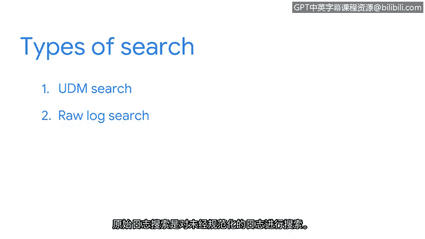
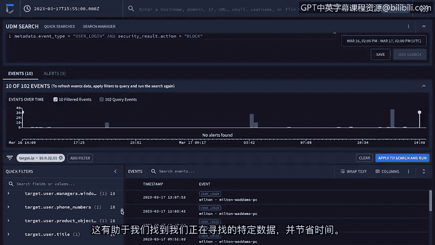

# 谷歌网络安全专业证书第六课：《拉响警报：检测与响应》（中英字幕，前面分p中字，后面分p英字） - P44：43_使用Chronicle查询事件.zh - GPT中英字幕课程资源 - BV1eV41157nD

Chronicle allows you to search and filter log data。 In this video。

 we'll explore using Chronicle search field to locate an event。

 Chronicle uses the Yra L language to define rules for detection。

 It's a computer language used to create rules for searching through ingested log data。For example。

 you can use R L to write a rule to detect specific activities related to the exfiltration of valuable data。

Using Chronicle search field， you can search for fields like host name， domain， I P， URL， email。

 user name or file hash。Using the search field， you can enter different types of searches。

 The default method of search is using UDM search， which stands for unified data model。

 It searches through normalized data。If you can't find the data you're looking for。

 searching the normalized data， you have the option of searching raw logs。

Rll log searches through the logs which have not been normalized。

From our earlier discussion on the SIim process， you may recall that raw logs get processed during the normalization step。

During normalization， all of the relevant information from raw logs gets extracted and formatted。

 making the data easier to search。A reason we might need to search raw logs is to find data that may not have been included in the normalized logs。

 like specific fields， which have not been normalized or to troubleshoot data ingestion problems。

 Let's examine a UDM search for a failed login using Chronicle。 First。

 let's click on the structured query builder icon so that we can perform a U DM search。

I'll type in the search metadata do event type， equal user login and securityreult do action equal block。

 Let's break down this UDM search。 Since we are searching for normalized data。

 we need to specify a search that uses UDM format。 UDM events have a set of common fields。

The metadata dot event type field details the events type here。

 We're asking Chronicle to find an authentication activity event。 a user log in。 Next， there's an。

 which is a logical operator that tells the search engine to contain both terms。 Finally。

 the security result dot action field specifies a security action such as allow or block。Here。

 the action is blocked。 This means the user login was blocked or failed。

Now we'll press the query button。We're going to focus on searching normalized data。

We're presented with a screen with the search results。 There's lots of information here。

 under UDM search， we can observe our search terms。

There's also a bar graph timeline visualizing the failed login events over a period。

 At a quick glance， this gives us a snapshot of the failed login activity over time。

 allowing us to spot possible patterns。Under the timeline。

 there's a list of events with times stampamps associated with this search。Under each event。

 there's an asset， which is the name of a device。 For example。

 this event shows a failed login for a user named Alice。 If we click the event。

 we can open up the raw log associated with the event。

 We can interpret these raw logs for more detail about the event's activity during the investigation。

To the left， theres quick filters。 These are additional fields or values that we can use to filter the search results。

 For example， if we click target do IP P， we are given a list of I P addresses。

If we click one of these IP addresses， we can filter the search results to contain only this target IP address。

 This helps us find specific data we're looking for and helps us save time in the process。

Great work。 Now， you know how to perform a search using Chronle in the upcoming activity。

 you'll have the chance to perform searches using the Sim tools we've just discussed。😊。

