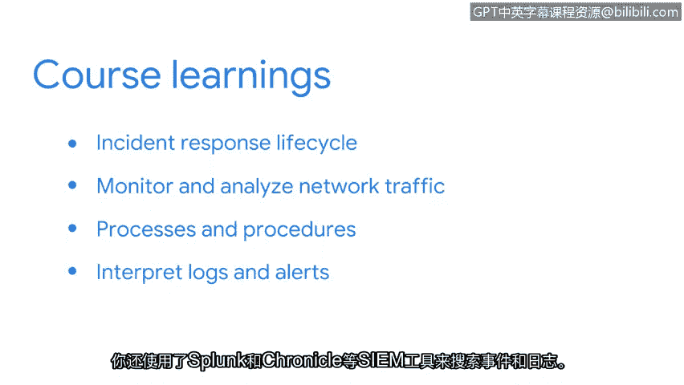

# 谷歌网络安全专业证书第六课：《拉响警报：检测与响应》（中英字幕，前面分p中字，后面分p英字） - P46：45_课程总结.zh - GPT中英字幕课程资源 - BV1eV41157nD

Congratulations on completing this course on detection and response。 As you've progressed。

 we've covered a wide range of topics and tools。 Let's take a moment to review what you've learned。

 First， we began with an overview of the incident response life cycle。

 You learned how security teams coordinate their response efforts。

 and you explored the documentation， detection and management tools used in incident response。 Next。

 you learned how to monitor and analyze network traffic。

 You learned about capturing and analyzing packets using packet s sniffs。

 You also practice using tools like TC P dump to capture and analyze network data to identify indicators of compromise。

😊，Then we explored processes and procedures involved in the phases of the incident response life cycle。

You learned about techniques related to incident detection and analysis。

 You also learned about documentation like chain of custody， playbooks and final reports。

We ended with exploring strategies used for recovery and post incident activity。 Finally。

 you learned how to interpret logs and alerts。 You explored Surrakata on the command line to read and understand signatures and rules。

 You also use Sim tools like Splunk and Chronicle to search for events and logs。😊。

As a security analyst， you'll be presented with a new challenge every day。

 whether it's investigating evidence or documenting your work。

 you'll use what you've learned in this course to effectively respond to incidents。

 I'm so glad to have been on this learning journey with you。

 You've done a fantastic job in expanding your knowledge and learning new tools to add to your security tool box。

 One of the things I love about the security field is that there's always something new to learn。

 And coming up， you'll continue your learning journey by exploring a programming language called Python。

 which can be used to automate security tasks。 Keep up the great work。😊。

