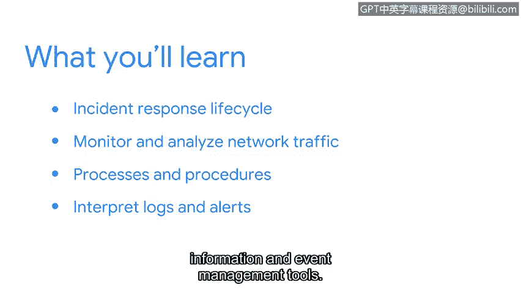

# 谷歌网络安全专业证书第六课：《拉响警报：检测与响应》（中英字幕，前面分p中字，后面分p英字） - P47：0_01_introduction-to-course-6.en_subtitled - GPT中英字幕课程资源 - BV1eV41157nD

Security attacks are on the rise， and new vulnerabilities are exploited and discovered every week。

 no matter how prepared an organization may be in the event of a security attack， at some point。

 something goes wrong。 whether it's a data breach， ransomware or a simple mistake made by an employee。

 incidents happen。And it's up to security professionals like you to effectively respond to security incidents。

Hello and welcome to the course。 I'm Dave， and I'm a principal security strategist for Google Cloud。

 I've 20 years of experience as a security practitioner and leader。 Over the past eight years。

 I've worked at industry leading security vendors like Forinette， Splunk and Google。

 where I developed a specialty in security analytics。😊。

I have a passion for helping analysts develop the skills necessary to succeed in their careers。

 I'm so happy you're here。 You've done a great job so far。

 You've learned a lot about security concepts， best practices and types of security attacks。 Now。

 in this course， we'll focus on incident detection， analysis and response。😊。

You'll have the opportunity to apply your learning using tools such as TCP dump， Wireshark。

 Surracottta， Splunk， and Chronicle。 By the end of this course。

 you'll have an in depth understanding of incident response。First。

 you'll learn about the incident response lifecycle and how incident response teams work together。

 You'll also learn about the types of tools used in detection and response， including documentation。

 You'll also be given your own incident handlers' journal that you'll use during your investigations。

 Next， you'll apply your knowledge in networking and Linux to monitor and analyze network traffic。

 using packet sniffers like Wireshark and TCP dump to capture and analyze packets for potential indicators of security incidents。

 Then you'll become familiar with the common processes and procedures used during incident detection and response。

 You'll learn how to use investigative tools to analyze and verify incidents and produce documentation。

 Finally， you'll learn how to interpret logs and alerts。

 You'll learn how detection tools produce logs and how these logs are analyzed in security information and event management tools。

Ready to begin。 Let's get started。

