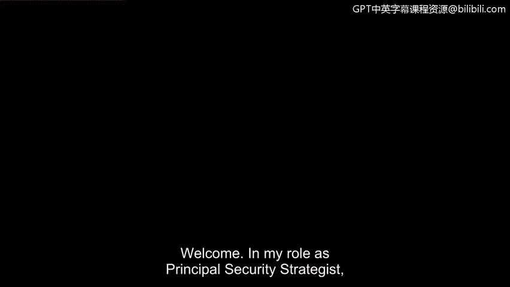
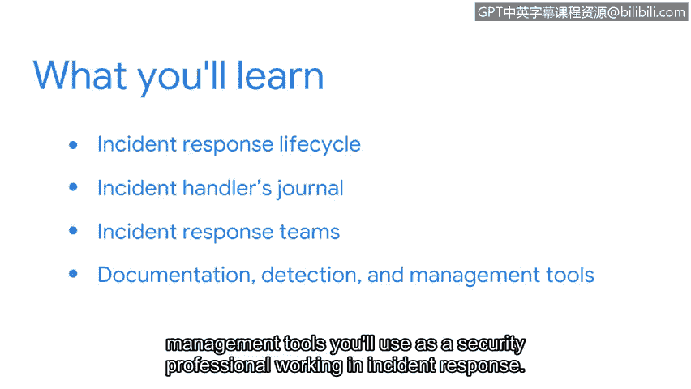

# 谷歌网络安全专业证书第六课：《拉响警报：检测与响应》（中英字幕，前面分p中字，后面分p英字） - P49：2_01_welcome-to-week-1.en_subtitled - GPT中英字幕课程资源 - BV1eV41157nD

Welcome， in my role as principal security strategist。

 I've seen how the incident response operations that you'll learn about in this course are implemented in an organization。

 One of the things I find so exciting about detecting and responding to incidents is the challenge of using data to understand what an adversary has done in my organization's environment。

 No two investigations are ever the same， But there are patterns of behavior that you can learn to spot as you hone your analytic skills。

😊，Previously， you established a solid understanding of asset security， threats and vulnerabilities。

 You explored the NISist cyberbersecur framework or CSF as a methodology for risk management。

 You learned about mitigating organizational risk through classifying and securing assets。

 and you also explored security and privacy controls to safeguard data。

 You used tools like mitre and CVE to investigate common vulnerabilities and used techniques like threat modeling to develop an attacker's mindset。

Next， we'll revisit the NIST CSF with a focus on the incidentci response lifecycle you'll be given your own incident handlers' journal。

 which you'll use throughout the rest of the course。

You'll also be introduced to incident response teams。

 including the different team roles and how they organize to respond to incidents。 And finally。

 you'll learn about the different types of documentation。

 detection and management tools you'll use as a security professional working in incident response。

Later on， you'll have an opportunity to use these tools。

Are you ready to begin your journey in detection and response， Let's begin。

