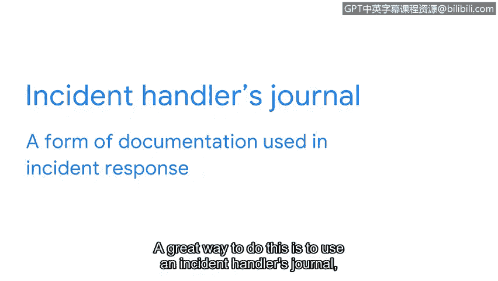

# 谷歌网络安全专业证书第六课：《拉响警报：检测与响应》（中英字幕，前面分p中字，后面分p英字） - P50：3_02_introduction-to-the-incident-response-lifecycle.en_subtitled - GPT中英字幕课程资源 - BV1eV41157nD

Incident life cycle frameworks provide a structure to support incident response operations。

 Frameworks help organizations develop a standardized approach to their incident response process so that incidents are managed in an effective and consistent way。

 There are many different types of frameworks that organizations can adopt and modify according to their needs。

 In this course will focus on the Nist CS SF。 then will expand on the CS SF and discuss the phases of the NISist incident response life cycle。

To recall， the five core functions of the Nist CS SF are identify， protect， detect。

 respond and recover。 This course will explore the last three steps of this framework。 detect。

 respond and recover。These last three steps are critical stages during incident response。

 and as an analyst， you'll detect and respond to incidents and implement actions for recovery。

The NIST incident response lifecycl is another NISistT framework with additional sub steps dedicated to incident response。

 It begins with preparation。Next， detection and analysis， and then containment。

 eradication and recovery。 And finally， post incident activity。

One thing to note is that the incident life cycle isn't a linear process。 It's a cycle。

 which means that steps can overlap as new discoveries are made。

 This life cycle gives us a blueprint of how to effectively respond to incidents。

 But before we dive into incident detection and response。

 let's take some time to understand what an incident is。According to NISistT。

 an incident is an occurrence that actually or imminently jeopardizes without lawful authority。

 the confidentiality， integrity or availability of information or an information system。

 or constitutes a violation or imminent threat of violation of law， security policies。

 security procedures， or acceptable use policies。Whoa， that's a lot to take in。 Let's break it down。

 It's important to understand that all security incidents are events。

 but not all events are security incidents。What are events？

An event is an observable occurrence on a network， system or device。Here's an example of an event。

 A user attempts to log into their email account， but they can't because they forgot their password。

The user then requests a password reset and successfully changes their password。

This is an observable event。 Well， why， Because systems and applications log password reset requests and logs provide evidence that something happened。

 We know that someone successfully requested a password reset and that they did not violate security policies to access the account。

Now， imagine that instead of the rightful owner of the account。

 a malicious actor trying to gain access to the account successfully initiated the password change request and changed the account password。

 This would be considered both an event and a security incident。

 It's an event because it's an observable occurrence。

 It's also a security incident because a malicious actor violated the security policy to unlawfully access an account that is not rightfully theirs。

😊，Remember， all security incidents are events， but not all events are security incidents。

 just like detectives working a case， carefully handle and document their evidence and findings。

 Security analysts are required to do the same when they investigate a security incident。

 An incident investigation reveals critical information about the five Ws of an incident。

 Who triggered the incident。What happened？When the incident took place。Where the incident took place。

And why the incident occurred。Keeping track of this information is essential。

 not only during an incident investigation， but also during the closure of an investigation when it comes time to write the final report。

As an analyst， you'll need a method to document and reference this information for easy access when you need it。

 A great way to do this is to use an incident handler's journal。

 which is a form of documentation used in incident response。

Throughout this course， you'll be using your own Incident handler journal to take notes of any incident details。

 we'll discuss more on documentation and the upcoming lessons。

