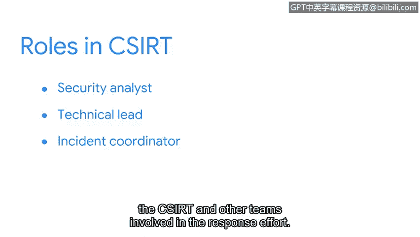

# 谷歌网络安全专业证书第六课：《拉响警报：检测与响应》（中英字幕，前面分p中字，后面分p英字） - P51：4_01_incident-response-teams.en_subtitled - GPT中英字幕课程资源 - BV1eV41157nD

Hi again。 In this section， we'll discuss how incident response teams manage incidents。

 You may have been part of a team before。 whether it was a sports team or a team in the workplace or at school。

 teamss are most successful when everyone uses their diverse strengths to work towards a common goal。

😊，Incident response teams aren't any different。 A successful response to security incidents doesn't happen in isolation。

 It requires a team of both security and non security professionals working together with defined roles。

Computer security incident response teams or CSEts are a specialized group of security professionals that are trained in incident management and response。

The goal of Certs are to effectively and efficiently manage incidents。

 provide services and resources for response and recovery and prevent future incidents from occurring。

 Security is a shared responsibility， which is why C Cts must work cross functionally with other departments to share relevant information。

 For example， if an incident resulted in the breach of sensitive data like financial documents or P I I。

 Then the legal team must be consulted。 Some regulatory compliance measures may require organizations to publicly disclose a security incident within a certain time frame。

 This means that CEts must collaborate with the organizations's public relations team to coordinate efforts for public disclosure。

So how exactly does a Cert function。 First， there's the security analyst。

 The analysts job is to investigate security alerts to determine if an incident has occurred。

If an incident has been detected， the analyst will determine the criticality rating of the incident。

 Some incidents can be easily remediated by the security analyst and don't require escalation。

 But if the incident is highly critical， it gets escalated to the technical lead who provides technical leadership by guiding security incidents through their life cycle。

During this time， the incident coordinator tracks and manages the activities of the C Ct and other teams involved in the response effort。

 Their job is to ensure that incident response processes are followed and that teams are regularly updated on the incident status。

 Not all Certs are the same。 depending on the organization。

 a Cert can also be referred to as an incident handling team or I H T or security incident response team。

 S I R T。

Depending on an organization's structure， some teams can also have a broader or specialized focus。

 for example， some teams may be solely dedicated to crisis management and others may be incorporated with a soC。

Rolls can have different names， too。 For example， a technical lead can also be known as an ops lead。

 Regardless of the team's title or focus， they all share the same goal。

 incident management and response。Now that you know a bit about incident response teams will'll continue to learn about how incident response teams plan。

 organize and respond to incidents。 I'll meet you in the next video。

