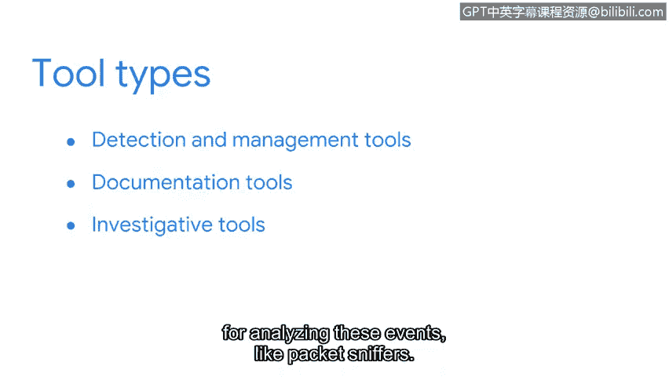

# 谷歌网络安全专业证书第六课：《拉响警报：检测与响应》（中英字幕，前面分p中字，后面分p英字） - P54：7_01_incident-response-tools.en_subtitled - GPT中英字幕课程资源 - BV1eV41157nD

As a security analyst， you'll play an important role in incident detection。 After all。

 you're going to be at the front lines actively detecting threats。To do this。

 you'll not only rely on the security knowledge you've developed so far。

 but you'll also be using a variety of tools and technologies to support your investigations。

A great carpenter doesn't just use a hammer to create a piece of furniture。

 They rely on a variety of tools in their tool box to get the job done。

 They'll need to use a tape measure to measure dimensions。

 a saw to cut wood and sand paperper to smooth the surface。Likewise， as a security analyst。

 you won't be using a single tool to monitor， detect and analyze events。

 you'll use detection and management tools to monitor system activity to identify events that require investigation。

 You'll use documentation tools to collect and compile evidence。

 and you'll also use different investigative tools for analyzing these events like packet sniffs。

New security technologies emerge。 threats evolve， and attackers become stealthier to avoid detection。

To become effective at detecting threats， you'll need to continuously expand your security toolbox。

 That's what makes the security field such an exciting one to be in。

 There's always something new to be learned。😊，You might remember the In handlers journal we shared with you from the previous section you'll be using this journal as your own form of documentation as you work through the rest of this course。

Consider this to be your first security tool to add to your toolbox。

