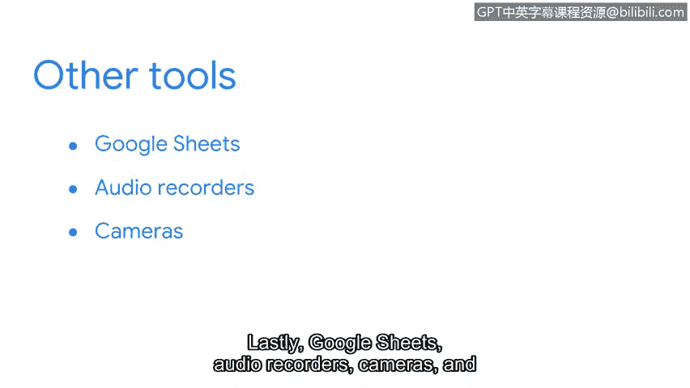

# 谷歌网络安全专业证书第六课：《拉响警报：检测与响应》（中英字幕，前面分p中字，后面分p英字） - P55：8_02_the-value-of-documentation.en_subtitled - GPT中英字幕课程资源 - BV1eV41157nD

Hi there。Previously， you learned how an incident handler's journal is used for documenting the five Ws of an incident。

 who， what， where， when and why an incident occurred in this section。

 we'll continue our discussion on documentation by exploring the different types of documentation。

 the importance of effective documentation and we'll finish off with a discussion on documentation tools。

Documentation is any form of recorded content that is used for a specific purpose。This can be audio。

 digital or handwritten instructions， and even videos。

 There is no set industry standard for documentation。

 So many organizations set their own documentation practices。Regardless。

 documentation is meant to provide instruction and guidance on a specific topic。

 There are also many types of documentation。 and you may already be familiar with some of them from the previous lessons。

 These include playbooks， In handlers journals， policies， plans and final reports。 Remember。

 there isn't an industry standard for documentation。

 which means that one organization's documentation practices may look completely different than another。

 Often， organizations will tailor their documentation practices according to their needs and legal requirements。

 They may add， remove or even merge documentation types。

Have you ever purchased a product and didn't know how to use it and consulted the product manual for instructions on how to do something like turn it on。

 congrats， you've used documentation to solve an issue。Previous。

 you've learned about how playbooks keep business operations safe and an incident response。

 Playbooks work similar to a product manual as a refresher。

 A playbook is a manual that provides details about any operational action。

 You'll learn more about playbooks later。Let's revisit that product manual example。

 Have you ever consulted a product manual for help and found yourself confused with the instructions and unable to get the help you needed。

Whether it's had to do with unclear visuals and instructions or a confusing layout。

 you weren't able to use the documentation to solve your issue。

 This is an example of ineffective documentation。Effective documentation reduces uncertainty and confusion。

 This is critical during a security incident when tensions are high and urgent response is required。

 As a security professional， you'll be using and creating documentation regularly。

It's essential that the documentation you use and produce is clear。

 consistent and accurate so that you and your team can respond swiftly and decisively。

 Word processors are a common way to document some popular tools to use our Google Docs， One note。

 Ever note and Noteeppa plus plus。Ticketing systems like JiRA can also be used to document and track incidents。

Lastly， Google sheetets， audio recorders， cameras and handwritten notes are also tools you can use to document。

Our discussion on documentation has only just begun。

 soon you'll use your Incident handlers journal to put your documentation skills to work。

