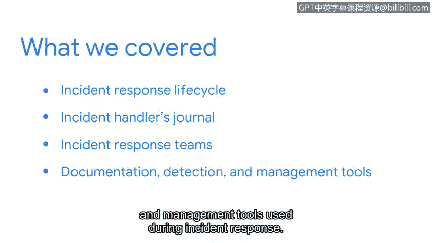

# 谷歌网络安全专业证书第六课：《拉响警报：检测与响应》（中英字幕，前面分p中字，后面分p英字） - P58：11_01_wrap-up.en_subtitled - GPT中英字幕课程资源 - BV1eV41157nD

Way to go。 you made it through a new section。 and you've learned a lot as a refresher。

 we first covered the incident response life cycle as a framework to support incident response processes。

 You were also given your very own incident handlers journal for your incident investigations。

 which you'll continue to use throughout this course。

You explored how incident response teams operate together to respond to incidents using incident plans。

 You also learned about the documentation， detection and management tools used during incident response。

Congrats on making it through the first part of your incident response journey。 Coming up。

 we'll explore network monitoring。 You'll also have the opportunity to apply your learning through the activities。

 I'll meet you in the next section。😊。