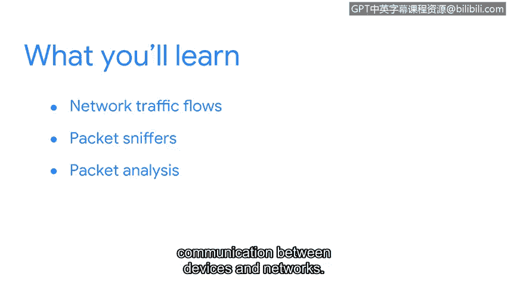

# 谷歌网络安全专业证书第六课：《拉响警报：检测与响应》（中英字幕，前面分p中字，后面分p英字） - P59：12_01_welcome-to-week-2.en_subtitled - GPT中英字幕课程资源 - BV1eV41157nD

Welcome back。 I'm so glad you're joining us。Previously。

 you were introduced to incident detection and response。

 You may also remember learning about networking from a previous course to recap。

 you learned about how devices talk to each other using network protocols and the different types of network attacks。

 You also examined some network security best practices。😊，Here。

 we'll expand on networking and shift our focus to network analysis。 First。

 you'll examine network communications by exploring network traffic flows。 Next。

 you'll learn about viewing and capturing network traffic using packet s sniffers。

 Then you'll be introduced to packet analysis where you'll examine packet fields and decode communication between devices and networks。

As a security professional， you'll be tasked with monitoring networks and system infrastructure to detect malicious activities。

And this section will provide you with the opportunity to develop your network and packet analysis skills。

 Are you ready to begin。 Let's get started。😊。

