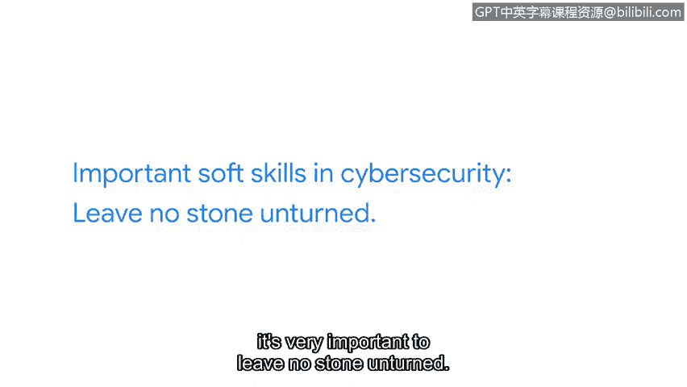

# 谷歌网络安全专业证书第六课：《拉响警报：检测与响应》（中英字幕，前面分p中字，后面分p英字） - P60：13_02_casey-apply-soft-skills-in-cybersecurity.en_subtitled - GPT中英字幕课程资源 - BV1eV41157nD

Hi， my name is Casey， and I'm part of the Google Cloud Enprise security sales team。 First of all。

 the biggest piece of advice I can give is do it。 I want you to be here。 We need all the people。

 It's a nonstop， ever changing world in cybersecurity， which is why it's such a fun place to be。

 We need more diversity and security。 We need everybody participating。

 We need people with diversity of thought， diversity of backgrounds， diversity of perspectives。

 I think some of the most important soft skills and cybersecurity are number one。

 being able to clearly summarize what you're trying to say。 massively important。

 One of the others soft skills that I think is。😊，Could even be more important than clear communication is working with an open mindset。

 the threat landscape。Is continuously changing。 The threat actors， the bad actors， they never sleep。

And so neither can we。 One of the things that makes cybersecurity so fun， In my opinion。

 is because it changes constantly。And if we have a fixed mindset going in。

And what I mean by a fixed mindset is， I think I know the answer to this。

 I think I understand exactly what's going on。 We are absolutely going to miss the boat。

 We need to be able to always stay curious。 And from a cyberseity point of view。

 it's very important to leave no stone unturned。

So one of the best things about soft skills is that we all have them。

 and we're already using them every single day。 So every one of you that's watching this already has a head start in cybersecurity。

😊。