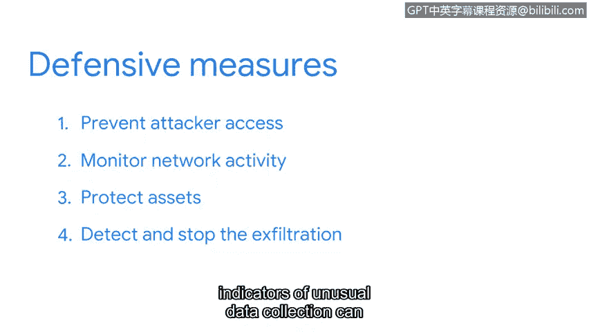

# 谷歌网络安全专业证书第六课：《拉响警报：检测与响应》（中英字幕，前面分p中字，后面分p英字） - P62：15_05_data-exfiltration-attacks.en_subtitled - GPT中英字幕课程资源 - BV1eV41157nD

Monitoring network traffic helps security professionals detect， prevent and respond to attacks。

In my experience as a security professional， monitoring for deviations from typical network traffic patterns has yielded big results。

 even if information is encrypted， monitoring network traffic is still important for security purposes。

Let's discuss how the detection and response process might work in a data exfiltration attack。 First。

 we'll outline the attacker's perspective。 before attackers can perform data exfiltration。

 they'll need to gain initial access into a network and computer system。

 This can be done through a social engineering attack like phishing。

 which tricks people into disclosing sensitive data。

 Aters can send phishing emails with attachments or links that trick their target into entering their credentials。

 Now， an attacker has successfully gained access to their device。

 After gaining their initial position into the system and attacker won't stop there。

 The goal for attackers is to maintain access in the environment and avoid being detected for as long as possible。

 to do this， they'll perform a tactic known as lateral movement or pivoting。

 This is when they'll spend time exploring the network with the goal of expanding and maintaining their access to other systems on the network。

 As an attacker pivots in the network。 They'll scope out the environment to identify valuable assets such as sensitive data like proprietary。

Personally identifiable information like names and addresses or financial records。

 They'll do this by searching locations such as network file shares， intranet sites。

 code repositories and more。After the attacker identifies the assets of value。

 they'll need to collect， package， and prepare the data for exfiltration outside of the organization's network and into the attacker's hands。

One way they may do this is by reducing the data size。

 This helps attackers hide the stolen data and bypass security controls。 Finally。

 the attacker will exfiltrate the data to their destination of choice。There are many ways to do this。

 For example， attackers can email the stolen data to themselves using the compromised email account。

Now that you've tapped into the attacker's perspective。

 let's explore how organizations can defend against this type of attack。 First。

 security teams must prevent attacker access。There are many methods you can use to protect your network from phishing attempts。

 For example， requiring users to use multifactor authentication attackers that gain access to a network can remain unnoticed for a while。

 It's important that security teams monitor network activity to identify any suspicious activity that can indicate a compromise。

 For example， multiple user logins coming from I P addresses outside of the network should be investigated。

 Earlier， you examined how to identify， classify and protect assets using asset inventories and security controls。

As part of an organization's security policy， all assets should be catalogued in an asset inventory。

 The appropriate security controls should also be applied to protect these assets from unauthorized access。

Lastly， if a data exfiltration attack is successful。

 security teams must detect and stop the exfiltration to detect the attack。

 indicatorators of unusual data collection can be identified through network monitoring。

 These include large internal file transfers， large external uploads and unexpected file rights。

SIim tools can detect and alert on these activities。Once an alert has been sent out。

 security teams investigate and stop the attack from continuing。

 There are many ways to stop an attack like this。 For instance。

 once the unusual activity is identified， you can block the I P addresses associated with the attacker using firewall rules。

Data exfiltration attacks are just one of many attacks that can be detected through network monitoring cominging up。

 you'll learn how to monitor and analyze network communications using packet sniffs。

