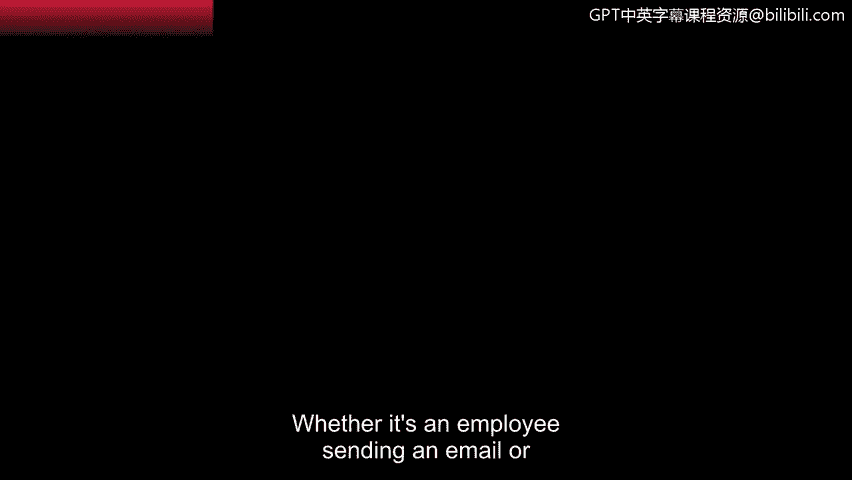
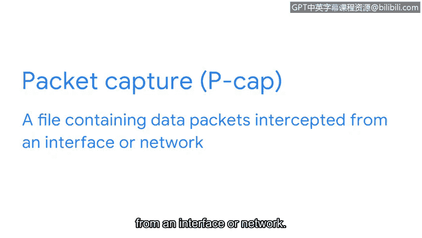

# 谷歌网络安全专业证书第六课：《拉响警报：检测与响应》（中英字幕，前面分p中字，后面分p英字） - P63：16_01_packets-and-packet-captures.en_subtitled - GPT中英字幕课程资源 - BV1eV41157nD

Whether it's an employee sending an email or a malicious actor attempting to exfiltrate confidential data。

 actions that are performed on a network can be identified through examining network traffic flows。

Understanding these network communications provides valuable insight into the activities happening in a network。

 This way， you can better understand what's going on in an environment and defend against potential threats。

With this in mind， let's examine how to record network traffic through packet captures。

Previous in the program， you learned that when data is sent， it's divided into packets。

 just like an addressed envelope in the mail， packets contain delivery information。

 which is used to route it to its destination。 This information includes as sender and receiver's I P address。

 The type of packet that's being sent and more。 packets can provide lots of information about the communications happening between devices over a network。

You may also recall that a packet has multiple components。There's the header。

 which includes information like the type of network protocol and port being used。

Imagine this as being the name and mailing address located on an envelope。

Network protocols are a set of rules that determine the transmission of data between devices on a network。

Ports are non physical locations on a computer that organize data transmission between devices on a network。

The header also contains the packets source and destination I P address。

 will explore more information contained in the header in a later section。Next， there's the payload。

 which contains the actual data that's being delivered。

 This is like the content of a letter inside of an envelope。And there's the footer。

 which signifies the end of a packet。So how exactly can you observe a network packet。

 just like scents are invisible， but can be smelled。

 packets are invisible but can be captured using tools called packet sniffers。You may remember。

 packet of sniffs from a previous section。A network protocol analyzer or packetet S sniffer is a tool designed to capture and analyze data traffic within a network。

As a security analyst， you'll use packet sniffers to inspect packets for indicators of compromise through packet sniffing。

 we can grab a detailed snapshot of packets that travel over a network in the form of a packet capture。

A packet capture or Pcap is a file containing data packets intercepted from an interface or network。

 It's sort of like intercepting an envelope in the mail。

Pca captures are incredibly useful during incident investigation by having access to the communications happening between devices over a network。

 you can observe network interactions and start to build a storyline to determine what exactly happened。

Coming up， we'll discuss the importance of packet analysis。 Me you there。

