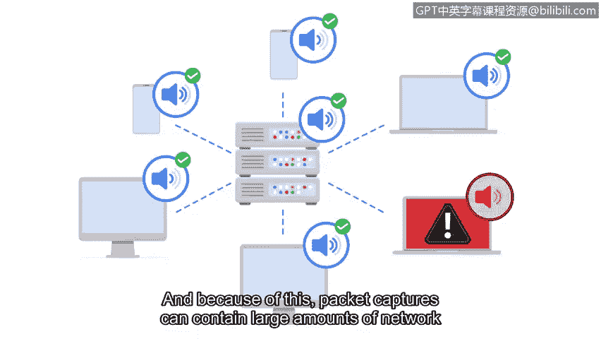

# 谷歌网络安全专业证书第六课：《拉响警报：检测与响应》（中英字幕，前面分p中字，后面分p英字） - P64：17_03_interpret-network-communications-with-packets.en_subtitled - GPT中英字幕课程资源 - BV1eV41157nD

If a packet capture is like intercepting an envelope in the mail。

 then packet analysis is like reading the letter inside of the envelope。

 Let's discuss how analyzing packets can help us interpret and understand network communications。

 As you may know， networks are noisy。 There's an enormous volume of communications happening between devices at any given time。

 And because of this， packet captures can contain large amounts of network communications。

 making analysis challenging and time consuming。

As a security professional， you'll be working against the clock to protect networks and computer systems from potential attacks。

You may analyze network evidence in the form of packet captures to identify indicators of compromise。

 having the ability to filter network traffic， using packet s sniffs to gather relevant information is an essential skill to have。

 For example， let's say that you were tasked with analyzing a packet capture to find any indication of data X filtration。

 How would you go about this。 using a network analyzer tool。

 you can filter the packet capture to sort packets。

 This can help you quickly identify an event associated with data X filtration like large amounts of data leading a database。

There are many other filters you can apply to packet captures to find the information you need to support an investigation efficiently。

Examples of network analyzer tools include TCP dump and wirereshark。

 TC P dump is accessed through a command line， While wirereshark has a graphical user interface or GuI。

 Both tools are useful for security analysts， and soon you'll have the opportunity to explore both。

Before we begin using these tools， let's explore packet fields in detail， specifically IP headers。

 meet you there。