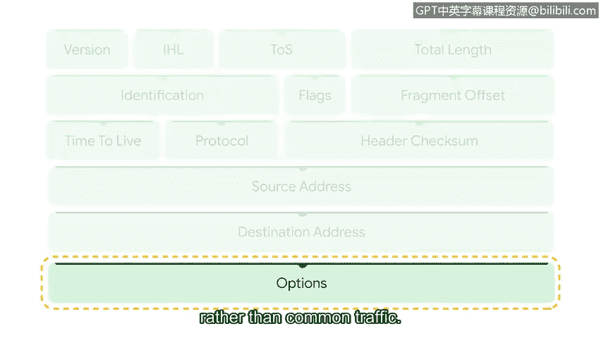

# 谷歌网络安全专业证书第六课：《拉响警报：检测与响应》（中英字幕，前面分p中字，后面分p英字） - P65：18_04_reexamine-the-fields-of-a-packet-header.en_subtitled - GPT中英字幕课程资源 - BV1eV41157nD

While there are many different tools available to use。

 it's important as a security analyst that you learn how to read and analyze packets manually To do so。

 let's examine an important packet component， I P headers。Previously。

 you learned about the four layers of the T CPP I P model。 Remember。

 the TCPI P model is a framework that is used to visualize how data is organized and transmitted across a network。

The Internet layer accepts and delivers packets for the network。

 It's also the layer where the Internet protocol operates as the foundation for all communications on the Internet。

 It's responsible for making sure packets reach their destinations。

The Internet protocol operates like a mail courier delivering an envelope。

 instead of using the delivery information found on the envelope。

 the Internet protocol uses the information found in a packet header like I P addresses。

 It then determines the best available route for packets to take so that data can be sent and received between hosts。

As you may already know， IP packets contain headers。

 headers contain the data fields essential to the transfer of data to its intended destination。

Different protocols use different headers。 There are two different versions of the Internet protocol。

 IPV 4， which is considered to be the foundation of Internet communications and IPV 6。

 which is the most recent version of the Internet protocol。 Remember。

 different protocols use different headers。 So IV 4 and IV6 headers differ。

 but they contain similar fields with different names。IPV4 is still the most widely used。

 so we'll focus on examining the fields of an IPV4 header。Let's start with the version field。

 which specifies which version of IP is being used， either IPV4 or IPV6。

Referring back to our mail analogy， the version field is like the different classes of mail like priority。

 express or regular。Next， IHL stands for Internet header length。

 This field specifies the length of the IP header plus any options。The next field， T， O。

 S stands for a type of service。 This field tells us if certain packets should be treated with different care。

For example， think of T O S like a fragile sticker on a mailed package。

Next is the total length field， which identifies the length of the entire packet。

 including the headers and the data。This can be compared to the dimensions and weight of an envelope。

The next three fields， identification， flags and fragment offset deal with information related to fragmentation。

Fragmentation is when an I packet gets broken up into chunks。

 which then get transmitted over the wire and reassembled when they arrive at their destination。

These three fields specify if fragmentation has been used and how to reassemble the broken packets in the correct order。

 This is similar to how mail can travel through multiple routes like mailbox's processing facilities。

 Aplans and mail trucks before it reaches its destination。 The T T L field stands for time to live。

 like its name suggests this field determines how long a packet can live before it gets dropped。

 Without this field， packets could loop through routers endlessly。 T T。

 L is similar to how tracking information provides details about an envelope's expected delivery date。

 The protocol field specifies the protocol used by providing a value which corresponds to a protocol。

 For example， T C P is represented by 6。 This is similar to including the number of a house in a postal address。

 The header checkum stores of value called a check some。

 which is used to determine if any errors have occurred in the header。

 The source address specifies the source I P address， and the destination address。

Specifies the destination IP address。This is just like the sender and receiver's contact information found on an envelope。

The options field is not required and is commonly used for network troubleshooting rather than common traffic。

 If it's used， the header length increases。

It's like purchasing postal insurance for an envelope。 Finally。

 at the end of the packet header is where the packet's data resides。

 like the text in an email message。 Who knew that the packets of data we send across networks contained so much information Com up soon。

 you'll have the opportunity to examine these packet fields in detail。

