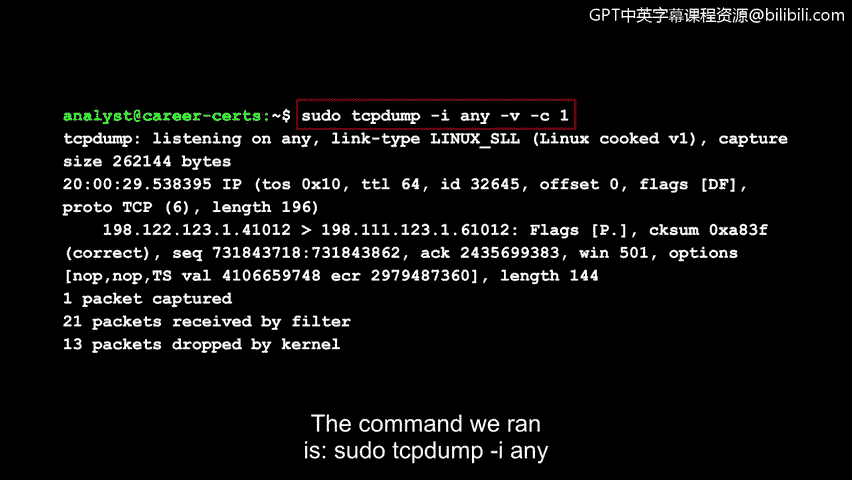
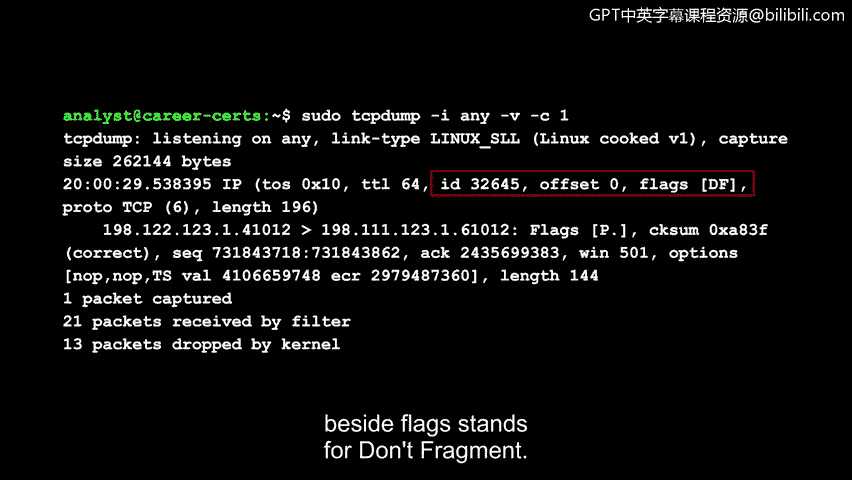
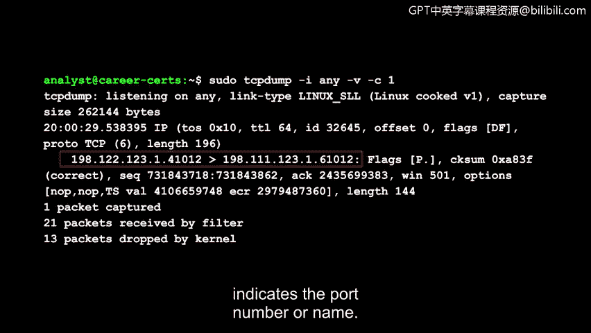
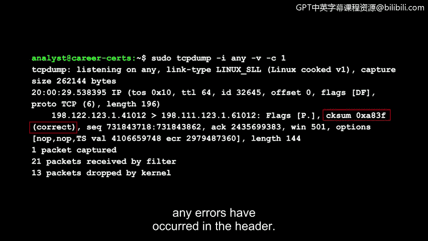
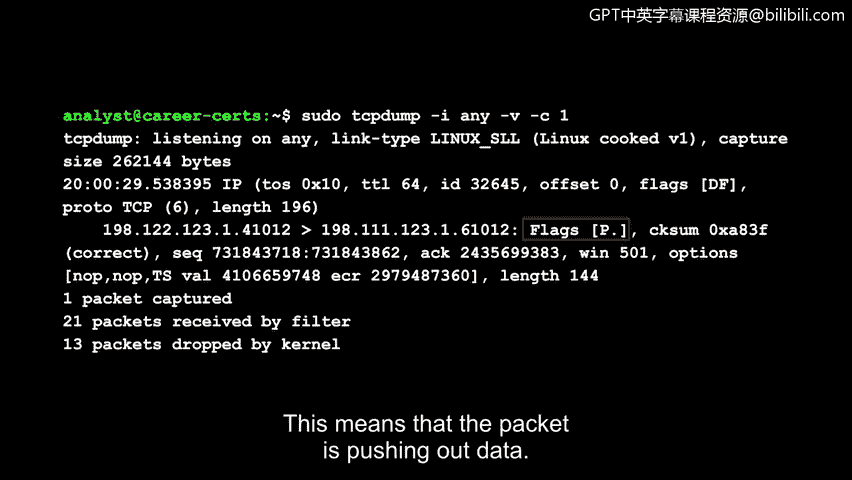

# 谷歌网络安全专业证书第六课：《拉响警报：检测与响应》（中英字幕，前面分p中字，后面分p英字） - P66：19_01_packet-captures-with-tcpdump.en_subtitled - GPT中英字幕课程资源 - BV1eV41157nD

TCP Dump is a popular network analyzer。 It's pre installed on many Linux distributions and can be installed on most Uni like operating systems like Mac O。

You can easily capture and monitor network traffic such as TCP， I P， ICMP， and many more。

TCP dump is a command line tool。 This means that it does not have a graphical user interface。

Earlier in the program， you learned that the command line is a very powerful and efficient tool。

 and will practice using it together with TCP dump。

 you can apply options and flags to your commands to easily filter network traffic so that you can find exactly what you're looking for。

 You can filter for a specific I P address， protocol or port number。

 Let's examine a simple TCP dump command used to capture packets。

 Keep in mind that your computer's traffic may appear different when you use this command。

At first glance， this looks like a lot of information。 Let's examine it， line by line。

The command we ran is pseudo， TCP dump， dash I， any， dash V， dash C，1。

We're using pseudoU because the Linux account we're logged in on doesn't have the permission to run TCP dump。

Then we specify TC P dump to start TCP dump and dash I to specify which interface we want to sniff traffic on The dash B stands for verbose。

 which displays detailed packet information。 The dash C stands for count。

 which specifies how many packets TCP dump will capture。Here， we've specified one。 Now。

 let's examine the output。 TC P Dump has told us that it's listening on any available network interfaces。

 And it's also given us additional information， like the capture size。

The first field is the packet's time stamp， which details the specific time of the packet travel。

 It begins with hours， minutes， seconds and fractions of a second。

Timetamps are especially helpful during an incident investigation when you want to determine timelines and correlate traffic。

Next， I P is listed as the version field。 It's listed as I P， which means its I P V4。

The verbose option has given us more details about the I packet fields。

 such as protocol type and the length of the packet。 Let's check it out。 The first field。

 T O S stands for type of service。Recall that this tells us if certain packets should be treated with different care。

 This is represented by a value in hexadecimal。The TTL field is time to live。

 which tells us how long a packet can travel across a network before it gets dropped。

The next three fields are identification offset in flags。

 which provide three fields with information relating to fragmentation。

 These fields provide instructions on how to reassemble packets in the correct order。 For example。

 the D F， beside flag stands for don't fragment。

Next， the proto is the protocol field。 It specifies the protocol in use and also provides us with the value that corresponds to the protocol Here。

 The protocol is TCP， which is represented by the number 6。

 The last field length is the total length of the packet， including the I P header。 Next。

 we can observe the I P addresses that are communicating with each other。

 The direction of the arrow indicates the direction of the traffic flow。

 The last piece of the I P address indicates the port number or name。

Next， the C， K sum or check sum field corresponds to the header check sum。

 which stores a value that's used to determine if any errors have occurred in the header here。

 it's telling us it's correct with no errors。 The remaining fields are related to T C P。 For example。

 Flags indicate TCP flags。 The P is the push flag， and the period indicates it's an ac flag。

 This means that the packet is pushing out data。 This is just one of many commands you can use in TC P dump to capture network traffic。

 Isn't it fascinating to observe all the information contained within these invisible packets。

 Go ahead and try it out for yourself。

