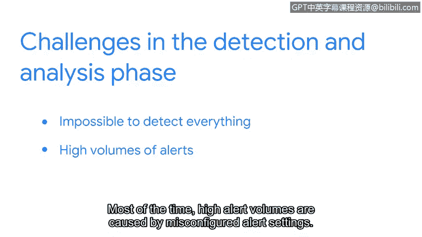

# 谷歌网络安全专业证书第六课：《拉响警报：检测与响应》（中英字幕，前面分p中字，后面分p英字） - P69：22_02_the-detection-and-analysis-phase-of-the-lifecycle.en_subtitled - GPT中英字幕课程资源 - BV1eV41157nD

Incidents happen， and as a security analyst， you'll likely be tasked with investigating and responding to security incidents at some point in your career。

 Let's examine the detection and analysis phase of the incident response life cycle。

 This is where incident response teams verify and analyze incidents。

Detection enables the prompt discovery of security events。Remember， not all events are incidents。

 but all incidents are events。 Events are regular occurrences in business operations like visits to a website or password reset requests。

 IS and SIim tools collect and analyze event data from different sources to identify potential unusual activity。

If an incident is detected such as a malicious actor successfully gaining unauthorized access to an account。

 then an alert is sent out。 Security teams then begin the analysis phase。

Analysis involves the investigation and validation of alerts。During the analysis process。

 analysts must apply their critical thinking and incident analysis skills to investigate and validate alerts。

 They'll examine indicators of compromise to determine if an incident has occurred。

 This can be a challenge for a couple of reasons。The challenge with detection is it's impossible to detect everything。

Even great detection tools have limitations in how they work。

 and automated tools may not be fully deployed across an organization due to limited resources。

Some incidents are unavoidable， which is why it's important for organizations to have an incident response plan in place。

Analysts often receive a high volume of alerts per shift， sometimes even thousands。 Most of the time。

 high alert volumes are caused by misconfigured alert settings。 For example。

 alert rules that are too broad and not tuned to an organization's environment create false positives。

 Other times， high alert volumes can be legitimate alerts caused by malicious actors taking advantage of a newly discovered vulnerability。

As a security analyst， it's important that you're equipped to effectively analyze alerts。

 And coming up， you'll do just that。