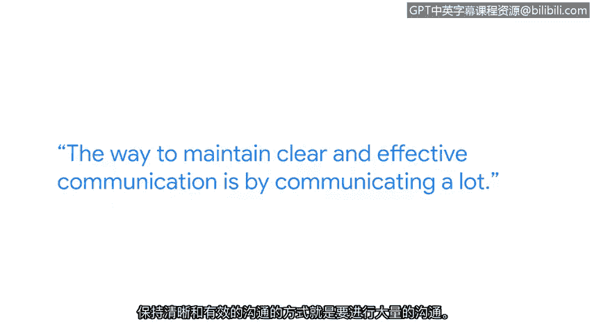

# 谷歌网络安全专业证书第六课：《拉响警报：检测与响应》（中英字幕，前面分p中字，后面分p英字） - P6：5_法蒂玛：在事件响应期间沟通的重要性.zh - GPT中英字幕课程资源 - BV1eV41157nD

My name is Fattima and I'm a tech lead manager on Google's detection and response team if there is a hacker on the network our job is to find them。

Working in detection is really like an artist preparing for a show。

 We spend all these time developing all of these signatures to detect hackers。 And then one day。

 it's time for the show。 You get that same nervous energy。

 And you question whether you're ready for the performance or not。

 for you really don't have a choice。😊，The hackers are going to come and you have to be ready for them。

I would say cybersecurity is very exciting。 You never know when the next。

Vulnerability is going to be released。 You never know when the next incident is going to happen。

 A great example of an incident would be the log for J vulnerability that happened in 2021。

 The entire company came together to investigate whether or not we were affected by this vulnerability。

 It was my team's job to make that determination。 So we ingest millions。

 hundreds of millions of lines of logs per second。 And after we have these logs。

 it requires hunting and log diving through them。Creating different signatures to match against these logs for signs of compromise。

 We were able to say， you know， all clear， we are not impacted by this， and we are safe。

 Like those are the moments。 Those are the highlights。 That's where everything comes together。

 Teamwork in an incident response scenario is key。 You cannot run an incident response。😊。

Without a really。A really solid team， a team that works really well together。

 a team that really trusts each other。 The way to maintain clear and effective communication is by communicating a lot。

 So during an incident， it's a little bit counterintuitive， but。

The people who are the more senior engineers， these people become the operational leads。

 and they are the people who are responsible for making sure that the communication is not breaking down within their function。

So we shift roles from being very technical to really focusing on the communication。

 aggregating the data and surfacing the data to the right people who need to know about it。

 I definitely recommend cybersecurity as a career field， because really the attackers。

 they're not going to let you get bored because they are very creative。

 So we have to be creative in the way that we go out looking for them。

 being a person who likes to learn knowing that there's always going to be a thing for me to learn and become good at。

 That's exciting。 And that keeps me motivated。😊。