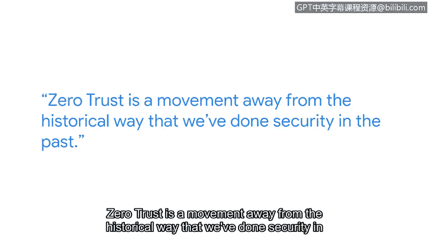

# 谷歌网络安全专业证书第六课：《拉响警报：检测与响应》（中英字幕，前面分p中字，后面分p英字） - P70：23_04_mk-changes-in-the-cybersecurity-industry.en_subtitled - GPT中英字幕课程资源 - BV1eV41157nD

Hi， I'm M。 K， director in the Office of the Cso for Google Cloud。

 the role of the chief Information Security officers both to protect Google Cloud from a security standpoint。

 but also to ensure that we providing all of the tools and products necessary so that our customers can achieve their security outcomes as well。

 So I spent a number of years in the US government32 years， In fact。

22 of which were spent as a special agent in the Federal Bureau of Investigation about midway through the course of my career I had the opportunity to shift in the cybersecurity lanes。

 which initiated or should I say reinitiated my interest in all things。

 computers and computer science。 One of the things that the industry lacks is a sense of agility that the adversary has in spades。

When they identify something that works for them， they continue to pound on it until and unless there's an obstacle。

 And then once that obstacle is put in their way， they have shown an ability to easily pivot their tactics and techniques so that they can bypass the obstacle in future attempts to gain access to environments。

 And so none of us can predict the future。 We're not at any kind of final stage。

 this is a continually evolving industry。 What you can ascertain is that we need to be prepared in a variety of ways to combat what will certainly be a persistent onslaught from the adversary。

 What that requires is a certain sense of agility。 You have to be comfortable in existing in the unknown。

 but you also have to have the intellectual aptitude in order to be able to digest and formulate new solutions on the fly。

 zero trust is a huge trend right now because it's both been a desire of the industry to move towards zero trust。

 but also a requirement in some areas around the world。

Zero trust is a movement away from the historical way that we've done security in the past。

 layman's terms， so you're a business traveler you travel with your business laptop and you check into your hotel halfway around the world and you need to get prepared and ready for a business meaning that's about to occur historically you'd want to be able to attest to the fact that that is an intended or qualified user within the enterprise attempting to gain access to this information and yes。

 based upon the information that you have the identity and coupling that with device information that user and device should have access to this information and be able to make a determination about it。

 I do believe that the more that we invest in the zero trust approach or architecture。

 it will get us to a good point from which the pivot off of but I think a lot of what's to come is unknown and that means continual learning It means continually exposing yourself to different parts of the industry so that。

We are prepared for what may happen in the future。