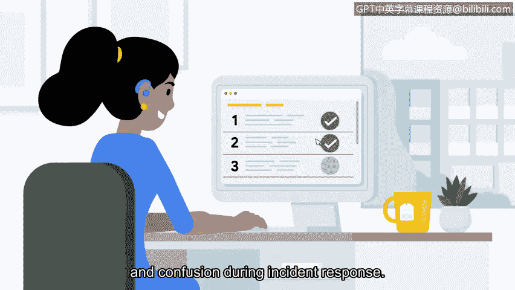

# 谷歌网络安全专业证书第六课：《拉响警报：检测与响应》（中英字幕，前面分p中字，后面分p英字） - P71：24_01_the-benefits-of-documentation.en_subtitled - GPT中英字幕课程资源 - BV1eV41157nD

You may recall our discussion on the different documentation tools and types used by security teams when responding to incidents。

In this video， we'll examine the benefits that documentation offers so that you can better understand how to leverage documentation as a security professional。

As a security engineer who has developed a great deal of detection rules。

 it was critical for me to document what it means when those rules are activated。

 what severity to assign， what might lead to false positives。

 and how the analyst can confirm the alert is legitimate without this documentation。

 a security operations team can never scale beyond one or two analysts。If something was documented。

 then there's a record of it happening。 This means that relevant information can be accessed。

 This is known as transparency。 Transpar documentation is useful as a source of evidence for security insurance claims。

 regulatory investigations and legal proceedings。 You'll learn more about documentation processes that help to achieve this in an upcoming section。

Documentation also provides standardization。 This means that there's an established set of guidelines or standards that members of an organization can follow to complete a task or workflow。

An example of creating standardization through documentation is establishing an organization's security policy。

 processes and procedures。This helps in maintaining quality of work。

 since there are set rules to follow。Documentation also improves clarity。

 Effective documentation not only gives team members a clear understanding of their roles and duties。

 but it also provides information on how to get the job done。 For example。

 playbooks that provide detailed instructions prevent uncertainty and confusion during incident response。

The security field is constantly changing。 At evolve， and regulatory requirements might change。

 This is why it's important to maintain， review and update documentation regularly。

 to keep up with any changes。 As a security professional。

 you'll likely juggle documentation responsibilities alongside your other tasks。

By taking the time to write down your actions， you'll recall facts and information。

 You may even notice some gaps in the previous actions you took。

 The time you spend documenting is valuable， not only for you， but for your entire organization。

