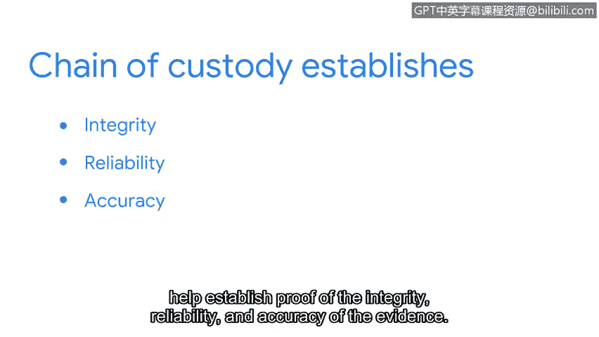

# 谷歌网络安全专业证书第六课：《拉响警报：检测与响应》（中英字幕，前面分p中字，后面分p英字） - P72：25_02_document-evidence-with-chain-of-custody-forms.en_subtitled - GPT中英字幕课程资源 - BV1eV41157nD

Let's continue our discussion on how documentation provides transparency through documents like chainin of custody。

During incident response， evidence must be accounted for during the entire incidents life cycle。

 Tracking evidence is important if the evidence is requested as part of any legal proceedings。

How can security teams ensure that this is done， They use a form called chain of custody。

 Chain of custody is the process of documenting evidence。

 possession and control during an incident life cycle。As soon as evidence gets collected。

 chain of custody forms are introduced。The form should be filled out with details as the evidence is handled。

 Let's examine a very simple example of how chain of custody is used during digital forensic analysis。

Previously， you learned that digital forensics is the practice of collecting and analyzing data to determine what has happened after an attack。

During an incident response， Ayesha verified that a compromised hard drive requires examination by the forensics team。

 First， she ensures that the hard drive is right protected。

 so the data on the disk can't be edited or erased。

 Then she calculates and records a cryptographic hash function of an image of the hard drive。

 Remember that a hash function is an algorithm that produces a code that can't be decrypted。

Ayesha is then instructed to transfer it to Collin in the forensics department。

 Colum examines it and sends it off to Naav。 Another analyst。

 Naav receives the compromised hard drive and sends it to her manager， Arman。

 Each time the hard drive is transferred to another person。

 They need to log it in the chain of custody form so that movement of evidence is transparent。

 Tampering with the data on the hard drive can be detected using the original hash that Ayesha documented at the beginning of the process。

 This ensures that there's a paper trail， describing who handled the evidence and why。

 when and where they handled it。Just like other documentation types。

 there is no standard template of what the chain of custody form should look like。

 but they do contain common elements。 This is what you might examine on a chain of custody log form。

First， there should be a description of the evidence。

 which includes any identifying information like the location， host name， Mac address， or IP address。

Next is the custody log， which details the name of the people who transferred and received the evidence。

 It also includes the date and time the evidence was collected or transferred and the purpose of the transfer。

 You may be wondering what happens if evidence gets logged incorrectly or if there's a missing entry。

This is what's known as a broken chain of custody， which occurs when there are inconsistencies in the collection and logging of evidence in the chain of custody。

In the Court of Law， chain of custody documents help establish proof of the integrity， reliability。

 and accuracy of the evidence。

For evidence related to security incidents， chain of custody forms are used to help meet legal standards so that this evidence can be used in legal proceedings。

If a malicious actor compromised a system， evidence must be available to determine their actions so that appropriate legal action can be taken。

 However， in some cases， major breaks in the chain of custody can impact the integrity。

 reliability and accuracy of the evidence。 This affects whether or not the evidence can be a trusted source of information and used in the court of law。

 Chain of custody forms provide us with a method of maintaining evidence so that malicious actors can be held responsible for their actions。

