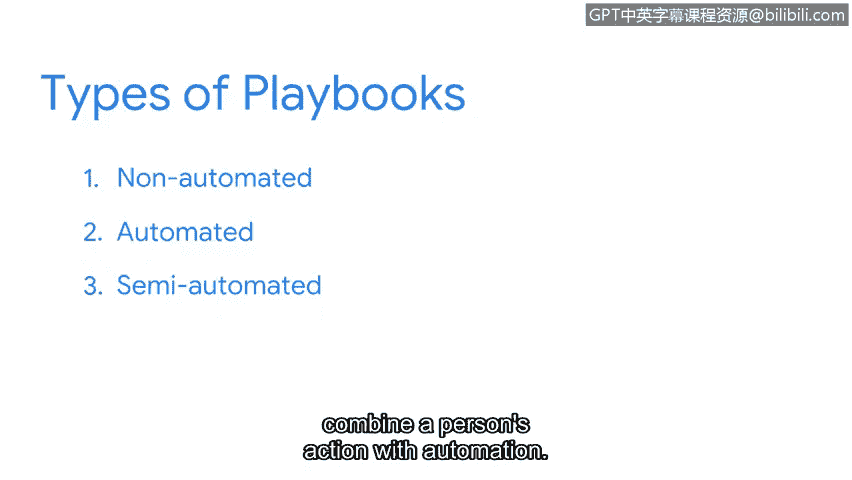

# 谷歌网络安全专业证书第六课：《拉响警报：检测与响应》（中英字幕，前面分p中字，后面分p英字） - P73：26_04_the-value-of-cybersecurity-playbooks.en_subtitled - GPT中英字幕课程资源 - BV1eV41157nD

Have you ever taken a trip to a place you've never visited before。

 You may have used a travel itinerary to plan your trip activities。

 Travel itineraries are essential documents to have， especially for travel to a new place。

 They help keep you organized and give you a clear picture of your travel plans。

 They detail the activities you'll do。 The places you'll visit。

 and your travel time between destinations。 Playbooks are similar to travel itineraries。

 As you may remember from our previous discussions。

 A playbook is a manual that provides details about any operational action。

 They provide security analysts with instructions on exactly what to do when an incident occurs。

 Playbooks provides security professionals with a clear picture of their tasks during the entire incident response life cycle。

Responding to an incident can be unpredictable and chaotic at times。

 Security teams are expected to act quickly and effectively。

 Playbooks offer structure and order during this time by clearly outlining the actions to take when responding to a specific incident by following a playbook。

 security teams can reduce any guesswork and uncertainty during response times。

This allows security teams to act quickly and without any hesitation without playbooks。

 an effective and swift response to an incident is nearly impossible within playbooks。

 there may be checklists that can also help security teams perform effectively during stressful times by helping them remember to complete each step in the incident response life cycle。

 Playbooks outline the steps that are necessary in response to an attack like ransomware。

 Data breach， malware or Ddos。Here's an example of a playbook that uses a flow chart diagram with the steps to take during the detection of a Diddos attack。

 This depicts the process for detecting a Diddos and begins with determining the indicators of compromise。

 like unknown incoming traffic。Once the indicators of compromise are determined。

 the next step is to collect the logs and finally analyze the evidence。

 There are three different types of playbooks， non automated， automated or semi automated。

The Ddos playbook we just explored is an example of a non automated playbook。

 which requires step by step actions performed by an analyst。Automated playbooks。

 automate tasks in incident response processes， for example。

 tasks such as categorizing the severity of the incident or gathering evidence can be done using an automated playbook。

Automated playbooks can help lower the time to resolution during an incident。

 Sore and Sim tools can be configured to automate playbooks。Finally。

 semi automated playbooks combine a person's action with automation。

 tedious error prone or time consuming tasks can be automated。

 while analysts can prioritize their time with other tasks。

 Semi automated playbooks can help increase productivity and decrease time to resolution。

As a security team responds to incidents， they may discover that a playbook needs updates or changes。

 Thrs are constantly evolving， and for playbooks to be effective。

 they must be maintained and updated regularly。A great time to introduce changes to playbooks is during the post incident activity phase。

 We'll be exploring more about this phase in an upcoming section。 Meet you there。😊。

