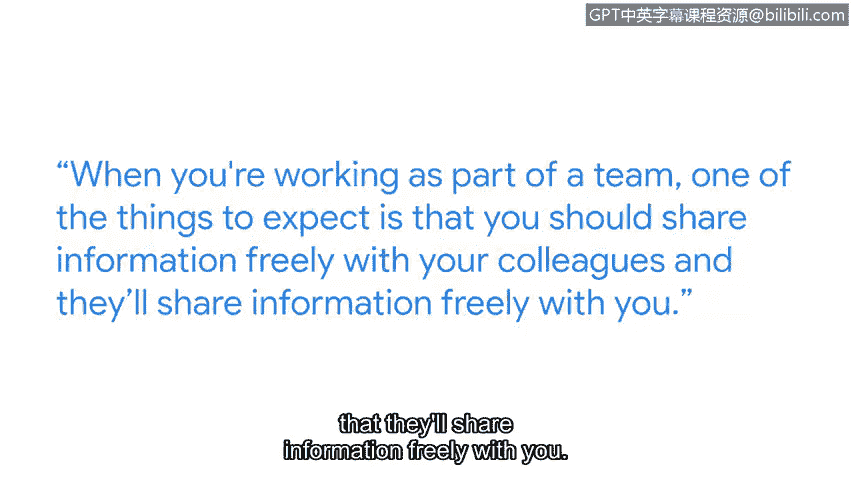

# 谷歌网络安全专业证书第六课：《拉响警报：检测与响应》（中英字幕，前面分p中字，后面分p英字） - P75：28_02_robin-foster-cross-team-collaboration.en_subtitled - GPT中英字幕课程资源 - BV1eV41157nD

My name is Robin and I am the program management lead for the Red team at Google。

 I would say teamwork might be the most important skill for people who work in cybersecurity。

 The collaborative culture is to understand that everybody brings a unique perspective and a useful perspective and useful skills。

 What it is about teamwork is that these problems are hard。 These problems are complex。

 The bad actors out there are smart。 They're well resourced and they're really motivated。

 So they're constantly coming up with new ways to do the activities that they want to do。

It takes people with all kinds of perspectives， all kinds of problemso skills。

 all kinds of knowledge to come together to understand what has happened and how we can defend against it。

 when you're working as part of a team， one of the things to expect is that you should share information freely with your colleagues and that they'll share information freely with you at the beginning and in the confusing part of responding to incidents。

 all information is useful， so expect to dive right in。

 share everything you know and listen to the things people around you say so that we come out with the best solutions as quickly as we can。

Very soon after I got into the role that that I am in now。

 we experienced a very significant incident。 A vulnerability was discovered in a library that was used in many。

 many different places on the Internet and the vulnerability was significant。

 I was part of the team that came together to respond to that。 And that team that came together。

 We set up response process that involved 24/7 coverage using our colleagues all around the world。

 The end result of the amazing teamwork that we experienced。 was， first of all。

 we were able to manage the vulnerability。 but more importantly。

 it's the the way the team came together afterward。

 and it's the way people still talk about how our great teamwork brought us closer to our colleagues meant that our teamwork better together than it did before meant that these teamwork aspects that all things that we do so well now We all feel like we've been through something together。

 and that we came out stronger。😊，On the other side， as you go through this certificate。

 you might learn that cybersecurity is tricky or it's hard， but don't give up the more you learn。

 the more you're going to enjoy it， so stay with it。

 learn everything you can and you're going to have a great career。

