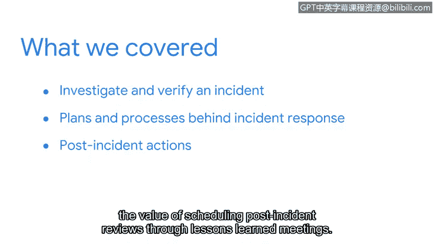

# 谷歌网络安全专业证书第六课：《拉响警报：检测与响应》（中英字幕，前面分p中字，后面分p英字） - P78：31_01_wrap-up.en_subtitled - GPT中英字幕课程资源 - BV1eV41157nD

That wraps up our discussion on incident investigation and response。

 Nice work on finishing up another section。 We've covered a lot here。

 So let's take a moment to quickly recap。 First， we revisited the detection and analysis phase of the Nist incident response life cycle and focused on how to investigate and verify an incident。

We discussed the purpose of detection and how indicators of compromise can be used to identify malicious activity on a system。

Next， we examine plans and processes behind the incident response， such as documentation and triage。

 We also explored strategies for containing and eradicating an incident and recovering from it。

 Finally， we examined the last phase of the incident life cycle， post incident actions。

 We talked about final reports， timelines and the value of scheduling post incident reviews through lessons learned meetings。

 as a security analyst， you'll be responsible for completing some processes involved in each phase of the incident response life cycle。

 Com up， you'll learn about logs and have the chance to explore them using a Sim。

