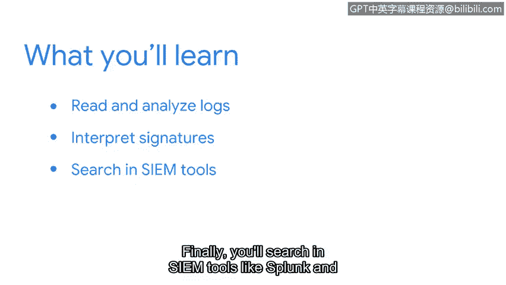

# 谷歌网络安全专业证书第六课：《拉响警报：检测与响应》（中英字幕，前面分p中字，后面分p英字） - P79：32_01_welcome-to-week-4.en_subtitled - GPT中英字幕课程资源 - BV1eV41157nD

History books， receipts， diaries。 What do all these things have in common， They record events。

Whether it's historical events， financial transactions or private diary entries。

 records preserve event details， and having access to these details can help us in many ways。

Previous， we explored the different types of processes and procedures involved during each phase of the incident response life cycle in this section will'll direct our focus on one of the key components of incident investigation logs and alerts。

In security， logs record event details， and these details are used to support investigations。 First。

 you'll learn all about logs， what they are and how they're created。

 You'll also learn how to read and analyze logs。 Then you'll revisit intrusion detection systems。

 You'll explore how to interpret signatures。 You'll have an opportunity to apply what you've learned through hands on activities using a tool called Sracottta。

Finally， you'll search in SIim tools like Splunk and Chronicle to locate events of interest and access log data。

Events are a valuable data source， They help create context around an alert so you can interpret the actions that took place on a system。

 knowing how to read， analyze and connect different events will help you identify malicious behavior and protect systems from attack。

Ready， let's begin。