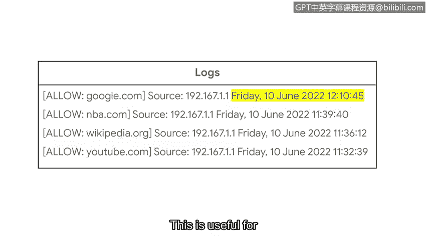

# 谷歌网络安全专业证书第六课：《拉响警报：检测与响应》（中英字幕，前面分p中字，后面分p英字） - P80：33_02_the-importance-of-logs.en_subtitled - GPT中英字幕课程资源 - BV1eV41157nD

Devices produce data in the form of events As a refresher。

 Even are observable occurrences that happen on a network， system or device。

This data provides visibility into an environment。 Logs are one of the key ways security professionals detect unusual or malicious activity。

 A log is a record of events that occur within an organization's systems。

System activity is recorded in what's known as a log file or commonly called logs。

 Almost every device or system can generate logs。 Los contain multiple entries which detail information about a specific event or occurrence。

 logs are useful to security analysts during incident investigation since they record details of what。

 where and when an event occurred on the network。 This includes details like date， time， location。

 the action made and the names of the users or systems who performed the action。

These details offer valuable insight not only for troubleshooting issues related to system performance。

 but most importantly for security monitoring。Logs allow analysts to build a story and timeline around various event occurrences to understand what exactly happened。

 This is done through log analysis。 Lo analysis is the process of examining logs to identify events of interest。

Since there are different sources available to get logs。

 and enormous volume of log data can be generated， it's helpful to be selective in what we log so that we can log efficiently。

 For example， Web applications generate a high volume of log messages。

 but not all of this data may be relevant to an investigation。 In fact， it may even slow things down。

 excluding specific data from being logged helps reduce the time spent， searching through log data。

You may recall our discussion on Sim technology。 Sim tools provide security professionals with a high level overview of what happens in a network。

 Sim tools do this by first collecting data from multiple data sources。

 Then the data gets aggregated or centralized in one place。 Finally。

 the diverse log formats get normalized or converted into a single preferred format。

Sim tools help process large log volumes from multiple data sources in real time。

 This allows security analysts to quickly search for log data and perform log analysis to support their investigations。

So how do logs get collected software known as log forwarders collect logs from various sources and automatically forward them to a centralized log repository for storage。

 Since different types of devices and systems can create logs。

 There are different log data sources in an environment。 These include network logs。

 which are generated by devices such as proxies， routers， switches and firewalls and system logs。

 which are generated by operating systems。There's also application logs。

 which are logs related to software applications。Security logs。

 which are generated by security tools like IDS or IPS， and lastly， authentication logs。

 which record login attempts。Here's an example of a network log from a router。

 There are a couple of log entries here， but we'll focus on the first line Here。

 we can observe a number of fields。 First， there's an action specifying allow。

 This means that the routers's firewall settings allowed access from a specific I P address to Google dot com。

Next， there's a field specifying the source， which lists an IP address。So far。

 the information from this log entry is telling us that network traffic to Google dot com from this source I P address is allowed。

 The last field specifies the times stampamp， which is one of the most essential fields in a log。

 We can identify the exact date and time of an action that's occurred。

 This is useful for correlating multiple events to develop a timeline of the incident。

There you have it。 You've analyzed your first network log Coming up。

 We'll continue our discussion on logs and explore log formats。

