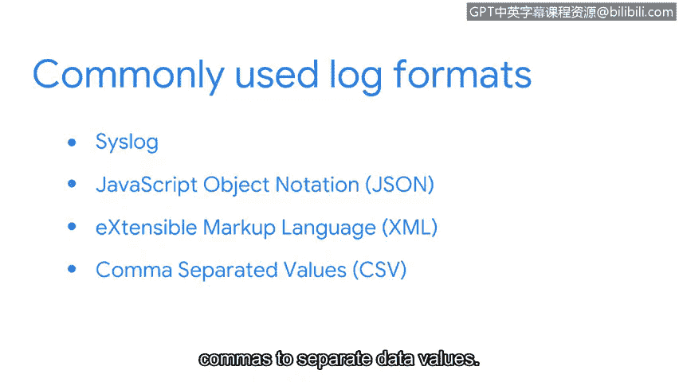

# 谷歌网络安全专业证书第六课：《拉响警报：检测与响应》（中英字幕，前面分p中字，后面分p英字） - P82：35_05_variations-of-logs.en_subtitled - GPT中英字幕课程资源 - BV1eV41157nD

When you purchase an item in a store， you usually receive a receipt as a record of purchase。

The receipt breaks down the transaction information with details such as the date and time。

 the cashier's name， the item name， cost and the method of payment。

 but not all store receipts look the same。For example。

 receipts like automotive invoices use lots of detail when listing the items or services that were sold。

 You most likely won't find this much detail from a restaurant receipt。

 Despite the differences among store receipts， All receipts contain important details that are relevant to the transaction。

 Los are similar to receipts。 While receipts record purchases。

 Los record the events or activities that happen on a network or system。As a security analyst。

 you'll be responsible for interpreting logs。Logs come in different formats。

 so not all logs look the same， but they usually contain information like timestamps。

 system characteristics like I P addresses， and a description of the event。

 including the action taken and who performed the action。

We know that logs can be generated from many different data sources， such as network devices。

 Opera systems and more。 These log sources generate logs in different formats。

 Some log formats are designed to be human readable， While others are machine readable。

 Some logs can be verbose， which means they contain lots of information。

 While some are short and simple。 Let's explore some commonly used log formats。

One of the most commonly used log formats is cislog。

 Sslog is both a protocol and a log format as a protocol。

 it transports and writes logs as a log format。 It contains a header followed by structured data and a message。

The Sslog entry includes three sections， a header， structured data and a message。

The header contains data fields like timest， the host name， the application name and the message I D。

The structured data portion contains additional data information in key value pairs。Here。

 the event source is a key that specifies the data source of the log， which is the value application。

Lastly， the message component contains the detailed log message about the event。 And this example。

 this as a log entry， is the message。Let's explore another common log format you might encounter as a security analyst。

Javascript object notation， more popularly known as JSO。

 is a text based format designed to be easy to read and write。

 It also uses key value pairs to structure data。Here's an example of a Json log。

 The curly brackets represent the beginning and end of an object。

 The object is the data that's enclosed between the brackets。 It's organized using key value pairs。

 where each key has a corresponding value separated by colons。 For example， for the first line。

 the key is alert。 and the value is malware。JSON is known for its simplicity and easy readability。

 as a security analyst， you'll use JSON to read and write data like logs。

Extensible markup language or XM L is a language and a format used for storing and transmitting data。

 Instead of key value pairs， it uses tags and other keys to structure data。

Here we have an example of an X， M L log entry with four fields。 First name， last name。

 employee I D and date joined， which are separated with arrows。Finally。

 comma separated values or CSV is a format that uses separators like commas to separate data values。

 In this example， there are many different data fields which are separated with commas。

Now that you know about the diversity of log formats。

 you can focus on evaluating logs to build context around a detection Coming up。

 you'll explore how IS signatures are used to detect， log and alert on suspicious activity。

