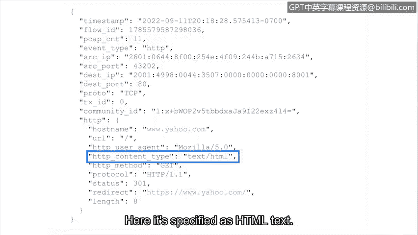

# 谷歌网络安全专业证书第六课：《拉响警报：检测与响应》（中英字幕，前面分p中字，后面分p英字） - P87：40_06_examine-suricata-logs.en_subtitled - GPT中英字幕课程资源 - BV1eV41157nD

Now， let's examine some logs generated by Surracottta in Surraccottta alerts and events are output in a format known as Eve JO。

 Eve stands for Extensible event format， and JO stands for JavaScriptscript Object notation。

As you previously learned， JSON uses key value pairs。

 which simplifies both searching and extracting text from log files。

Surrakata generates two types of log data， alert logs， and network telemetry logs。

Alert logs contain information that's relevant to security investigations。 Usually。

 this is the output of signatures， which have triggered an alert。 For example。

 a signature that detects suspicious traffic across the network generates an alert log that captures details of that traffic。

While network telemetry logs contain information about network traffic flows。

 network telemetry is not always security relevant。

 it's simply recording what's happening on a network。

 such as a connection being made to a specific port。

Both of these log types provide information to build a story during an investigation。

 Let's examine an example of both log types。Here's an example of an event log。

 We can tell that this event is an alert because the event type field says alert。

There is also details about the activity that was logged， including I P addresses and the protocol。

 There are also details about the signature itself。

 such as the message and I D From the signature's message。

 It appears that this alert relates to the detection of malware。Next up。

 we have an example of a network telemetry log which shows us the details of an HTTP request to a website。

The event type field tells us it's an H T T P log。 There's details about the request。

 Under host name， there's the website that was accessed。

 The user agent is the name of software that connects you to the website。 In this case。

 it's the Web browser， Mozilla 5。0。 and the content type。

 which is the data the H T T P request returned。Here， it's specified as H T M L text。

 That sums it up on the different types of log outputs。 in the upcoming activity。

 you'll be applying what we just explored by getting hands on with Surracottta。 Have fun。

