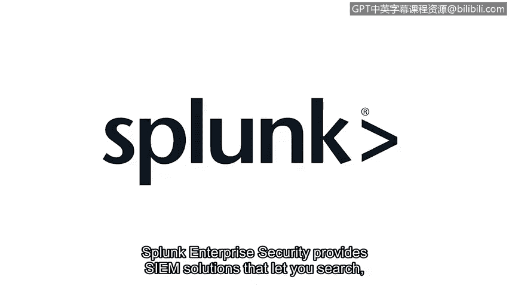

# 谷歌网络安全专业证书第六课：《拉响警报：检测与响应》（中英字幕，前面分p中字，后面分p英字） - P88：41_01_reexamine-siem-tools.en_subtitled - GPT中英字幕课程资源 - BV1eV41157nD

As a security analyst， you'll need to be able to quickly access the relevant data required to perform your duties。

 whether it's triaging alerts， monitoring systems or analyzing log data during incident investigations。

 as Sim is the tool for this job as a quick review。

 A Sim is an application that collects and analyzes log data to monitor critical activities in an organization。

 It does this by collecting， analyzing and reporting on security data from multiple sources。

 previously， you learned about the Sim process for data collection。 Let's revisit this process。

 First， Sim tools collect and process enormous amounts of data generated by devices and systems from all over an environment。

 Now， all data is the same。 As you already know， devices generate data in different formats。

 This can be challenging because there is no unified format to represent the data。

Sim tools make it easy for security analysts to read and analyze data by normalizing it。

 Ra data gets processed so that it's formatted consistently and only relevant event information is included。

 Finally， Sim tools index the data so it can be accessed through search。

All of the events across all the different sources can be accessed with your fingertips。

 Isn't that useful， Sim tools make it easy to quickly access and analyze the data flows happening across networks in an environment as a security analyst you may encounter different Sim tools。

 It's important that you're able to adjust and adapt to whichever tool your organization ends up using。

With that in mind， let's explore some SIim tools currently used in the security industry。

 Splunk is a data analysis platform。 Splunk enterpriseterse security provides Sim solutions that let you search。

 analyze and visualize security data。 First， it collects data from different sources。

 that data gets processed and stored in an index。 Then it can be accessed in a variety of different ways。

 like through search。

Chronicle is Google Cloud Sim， which stores security data for search， analysis and visualization。

First， data gets forwarded to Chronicle。 This data then gets normalized or cleaned up。

 so it's easier to process and index。 Finally， the data becomes available to be accessed through a search bar。

 Next up， we'll explore how to search on these Sim platforms。

