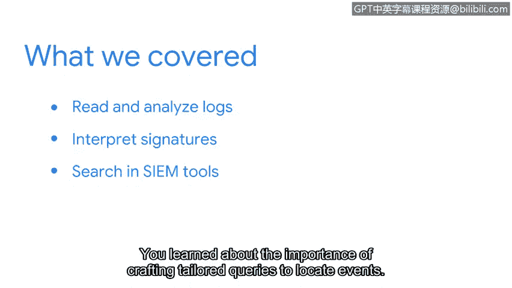

# 谷歌网络安全专业证书第六课：《拉响警报：检测与响应》（中英字幕，前面分p中字，后面分p英字） - P91：44_01_wrap-up.en_subtitled - GPT中英字幕课程资源 - BV1eV41157nD

Congratulations， you made it to the end of this section。

 You've made so much progress in your security journey。 Let's review what we learned。😊。

You learned all about how to read and analyze logs。

 You examined how log files are created and used for analysis。

 You also compared different types of common log formats and learned how to read them。

 You extended your understanding on intrusion detection systems by comparing network based systems and host based systems。

 You also learned how to interpret signatures。 You examined how signatures are written and also how they detect。

 log and alert on intrusions。 You interacted with serrakata in the command line to examine and interpret signatures and alerts。

 Lastly， you learned how to search in Sim tools like Splunk and Chronicle。

 You learned about the importance of crafting tailored queries to locate events。

At the forefront of incident response， monitoring and analyzing network traffic for indicators of compromise is one of the primary goals。

 Being able to perform in depth log analysis and knowing how to read and write signatures and how to access log data are all skills that you'll use as a security analyst。

