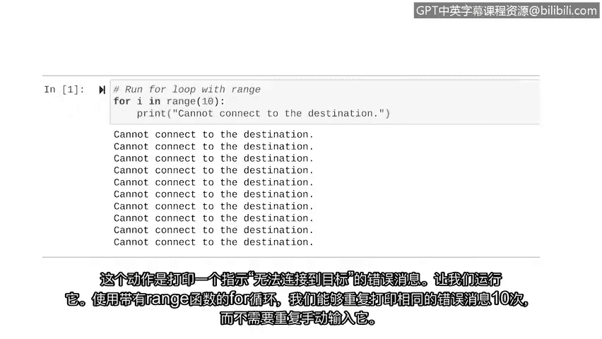

# 谷歌网络安全专业证书第七课：《用Python自动化网络安全任务》（中英字幕，前面分p中字，后面分p英字） - P10：9_使用for循环.zh - GPT中英字幕课程资源 - BV1Dp4y1G759

We just learn about conditional statements and how they can develop to allow computers to make decisions。

 but sometimes we need our programs to simply count or perform a task over and over again。

When it comes to tasks that are tedious， it's normal for humans to lose focus and energy。

 It's in situations like these where computers can be especially helpful。 In this video。

 we'll examine how computers can perform repetitive tasks using iterative statements and iterative statement is code that repeatedly executes a set of instructions。

 Iterative statements are also referred to as loops。

Setting up a loop allows us to repeatedly use a line of code without having to type it multiple times before discussing causing the syntax。

 Let's run a loop so you can experience what happens。

Notice how this code printed all the numbers in the list with only one printed statement。

 That's a loop。There are two types of loops we'll explore，4 loops and wild loops。

We just ran a for loop and we'll continue to focus on them in this video。Later。

 we'll explore wild loops。4 loops， repeat code for a specified sequence。

An example of these would be using a for loop to print every item in a list。

4 loops begin with the keyword 4。4 signals the beginning of a for loop。

Similar to conditional statements。Iterative statements consist of two main parts。

The parts of a loop are the loop header and the loop body。Let's examine the for loop。 we just run。

And use that to explore these parts。The loop header is the line that contains the four keyword and ends with a column。

He tells Python to start a loop。It consists of the four keyword。

A loop variable and the sequence the loop will iterate through。

The loop variable is a variable that is used to control the iterations of a loop。

The loop variable comes directly after4。A common name for it is the letter I。

 but you can give it any other name you want in four loops。

 This temporary variable is only used within the loop and nor outside of it in the rest of the code。

The loop variable is followed by the in operator， and the sequence the loop will iterate through。

In this example， these sequence is a list containing numbers from 1 through 4。

It runs each of these numbers through a specified action。

We need to remember to put a column at the end of the loop header to introduce this code。

The loop body refers to the indented lines after the loop header。

These represent the actions that are repeated while the loop iterates。In this case。

 it will print each number in the list。 first one。And then two， and so on。

Another important use of for loops is to repeat a specific process as set a number of times。

And this is done through combining it with the range function。

The range function generates a sequence of numbers。As an example。

 range from 0 to 10 sets a sequence that goes from 0，1 to all the way up until the number 9。

When we use range， we start counting at the number in the first position， in this case，0。

Then when we reach the number in the second position， it tells us where to stop。

That number is excluded。 So in this case， where the number is 10， the sequence only goes up until 9。

An important detail about the range function is that if we don't provide a start point。

 it automatically starts from 0。10 represents the stop point。 Since the stop point is excluded。

 the numbers included in the sequence is start at 0 and end at 9。

A sequence that is starts at 0 and ends at 9 will it 10 times。

Let's run a for loop that incorporates the range function。

We'll use rangech to ask Python to repeat an action 10 times。

 and then we'll indicate the action we want to repeat。

This action is printing a error message that indicates cannot connect to the destination。

Let's run this。Using a for loop with the range function allowed us to repeat the same error message 10 times instead of typing it over and over again ourselves。

In this video， we learn about the syntax and the structure of iterative statements。

And work with for loops， as an example。In the next video。

 we'll cover another type of iterative statement。 the while loop。

