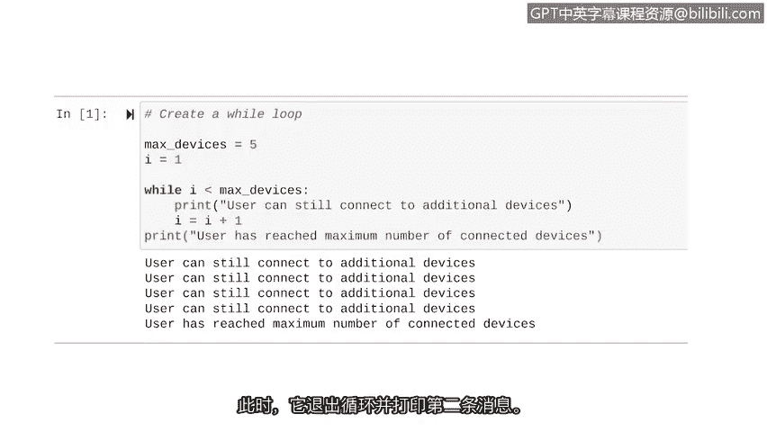
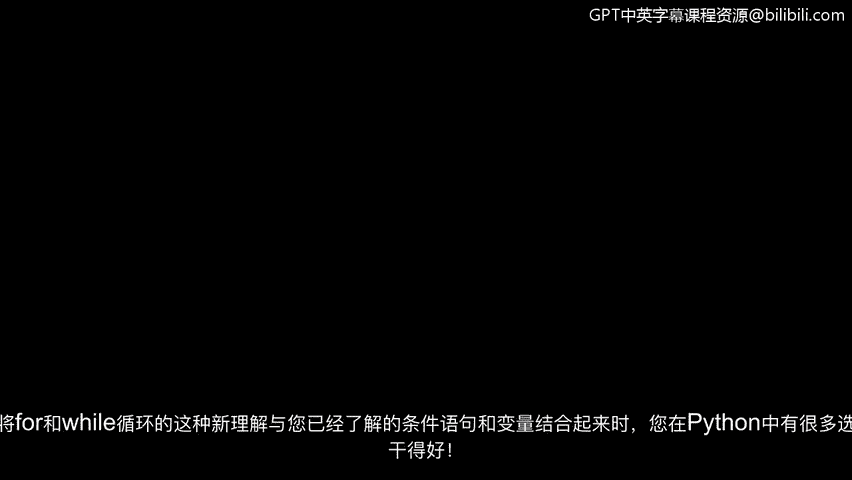

# 谷歌网络安全专业证书第七课：《用Python自动化网络安全任务》（中英字幕，前面分p中字，后面分p英字） - P11：10_使用while循环.zh - GPT中英字幕课程资源 - BV1Dp4y1G759

Previously， we introduced iterative statements in Python and focus on for loops。

 An iterative statement is code that repeatedly executes a set of instructions。 In this video。

 we'll explore another type of iterative statement， the while loop。😊，When we use four loops。

 the code repeatedly executed based on a specified sequence。

 while loops is still repeatedly executed。ButThis repetition is based on a condition。

As long as the condition is true。The loop continues to execute。 But when it becomes false。

 the while loop stops。 This while loop， for example。

 sets a condition where the variable time must be less than or equal to 10。

 This means it will keep running until the variable time is greater than 10。 similar to the for loop。

 A while loop has a header。It consists of the keyword， while。The condition。 and a colon。

The while loop starts with the keyword while。The keyword while signals the beginning of a while loop。

 and is followed by the condition that evaluates to a boolean value of either true。Or falses。

The condition contains the loop variable。This variable is used to control the number of loop iterations。

 However， there is an important distinction in the variables used in four and while loops with while loops。

 The variable isn't created within the loop statement itself。 before writing the while loop。

 you need to assign the variable。 Then you'll be able to reference it in the loop。

 when the condition containing the loop variable evaluates to true。 The loop iterates。

 If it does not。Then the loop stops。 This condition will evaluate to true while the variable time is less than or equal to 10。

 Finally， the loop header ends with a column。Just like a for loop。

 a wide loop has an indented worry that consists of the actions to take while the loop iterates。

The intention of this code is to print the value of a variable that represents the time and increase its value by 2。

Until it becomes greater than 10。This means the first action in this while loop is to simply print the current value of the time variable。

Since while loops do not include a sequence to iterate through。

 we have to explicitly define how the loop variable changes in the body of the while loop。

 For example， in this while loop， we increase the loop variable time by2 every iteration。

 This is because we only want to print the time every two minutes。

 So this while loop prints out all even numbers less than or equal to 10。

Now that we know the basics of while loops， let's explore a practical example。

 Imagine we have a limitation on how many devices a user can connect to。

We can use a Y loop to print a message when the user has reached their maximum number of connected devices。

Let's create a while loop for this。Before we start our while loop。

 we need to assign values to two variables。First， we'll set the maximum value of connected devices to 5。

Then we'll set our loop variable。 We'll use I for this and set it to a value of one。

Unlike with four loops with wire loops， we set this variable outside of the loop。 Next。

 we'll create the heather of our while loop。 In this case。

 the condition is that the first variable is less than the second variable。

Those variables are the loop variable I and max devices。 since we know the value of max devices is 5。

 we can understand that this loop will run as long as the current value of I is less than 5。

Then we indicate what we want our wild loop to do。Because this loop runs as long as the user can still connect to devices。

We'll first have it print。 a user can still connect to additional devices message。After this。

 with each iteration， will increment I by 1。When the loop repeats。

 it will use the new value of the I variable。Python will exit the loop when I is no longer less than 5。

Let's also print a message when this happens。We stop indenting because this next action occurs outside of the loop。

Then Wprint user has reached maximum number of connected devices。Okay， we're ready to run this。

Because of the loop， the first message prints a total of four times。

The lus stops when the value of I increments to 5。At this point。

 it exits the loop and prints the second message。

Well， when you combine these new understanding of four and while loops with what you already know about conditional statements and variables。

 you have a lot of options in Python。Great work。

