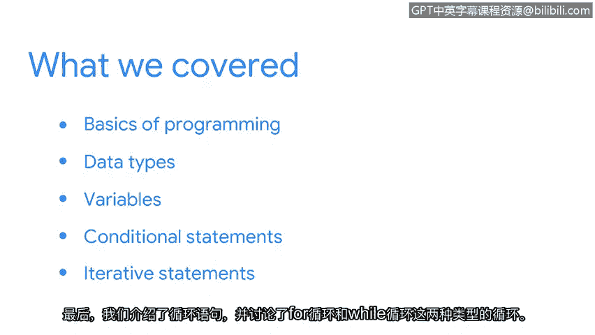

# 谷歌网络安全专业证书第七课：《用Python自动化网络安全任务》（中英字幕，前面分p中字，后面分p英字） - P12：11_总结.zh - GPT中英字幕课程资源 - BV1Dp4y1G759

Well done， you've learn about why security analysts use Python and the basic structure of a program。

Youre even read in some lines of Python code。Let's review what you learned so far。

You first learn about the basics of programming and why it's a very important tool for security analysts。

 You also learn some of the basic concepts of how programming languages work。

 You then learn to recognize data types in Python。 We focus on a string integer float Boolean and least data。

 Next， we focused on working with variables。 you then learned all about conditional statements and how to check for logical conditions using Python statements。

 Lastly， we work with iterative statements and discuss the two types of loops， for and while loops。

You'll use this knowledge as you progress through this course and in your career as a security analyst。

In the next section， we'll explore other important components of Python， including functions。

