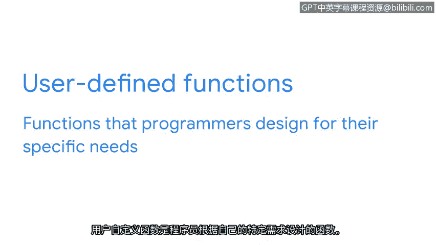

# 谷歌网络安全专业证书第七课：《用Python自动化网络安全任务》（中英字幕，前面分p中字，后面分p英字） - P14：13_函数入门.zh - GPT中英字幕课程资源 - BV1Dp4y1G759

As the complexity of our programs grow， it's also likely that well reuse the same lines of code。

 writing this code multiple times would be time consuming， but luckly， we have a way to manage this。

 We can use functions。A function is a section of code that can be reused in a program。

We already learned one function when we work with print and use it to output specified data to the screen。

For example， we printed hello Python。There are many other functions。

 Sometimes we need to automate a task that might otherwise be repetitive if we did it manually。

Previously， we compared other key Python components to elements of a kitchen。

 We compared data types to categories of food。There are differences in how we handle vegetables and meat。

 and likewise， there are differences in how we handle different data types。

We then discussed how variables are like the containers you put food in after a meal。

What they hold can change。As far as functions， we can think about them like a dishwasher。

 If you aren't using a dishwasher， you'll spend a lot of time washing each dish separately。

But a dishwasher automates this and lets you wash everything at once。Similarly。

 functions improve efficiency。They perform repetitive activities within a program and allow it to work effectively。

😊，Functions are made to be reused in our programs。They consist of small instructions and can be called upon any number of times and from anywhere in our programs。

Another benefit to functions is that if we ever had to make changes to them。

 we can make those changes directly in the function， and they'll be applied everywhere we use them。

This is much better than making the same changes in many different places within a program。

The print function is an example of a building function。

 Building functions are functions that exist within Python and can be called directly。

They are available to us， by default。We can also create our own functions。

 Use defined functions are functions that programmers design for their specific needs。

Both type of functions are like mini programs within a larger program。

They make working in Python much more effective and efficient。

Let's continue learning more about them。