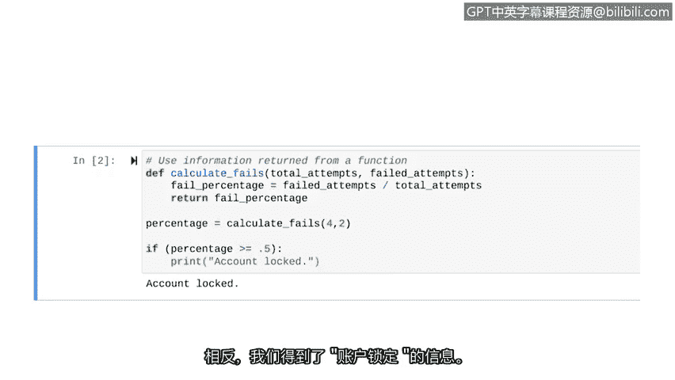

# 谷歌网络安全专业证书第七课：《用Python自动化网络安全任务》（中英字幕，前面分p中字，后面分p英字） - P17：16_返回语句.zh - GPT中英字幕课程资源 - BV1Dp4y1G759

We previously learned how we can pass arguments into a function。

We can do more than pass information into a function。We can also send information out of one。

Returned statements allow us to do this。A return statement is a python statement that executes inside a function and sends information back to the function call。

D ability to send information back from a function is useful to a security analyst in various ways。

As one example， an analyst might have a function that checks whether someone is allowed to access a particular file and will return a Boolean value of true or false to the larger program。

We'll explore another example。Let's create a function related to analyzing login attempts。

Based on the information it takes in。This function will compute the percentage of failed attempts。

 and return this percentage。The program could use this information in a variety of ways。 For example。

 it might be used to determine whether or not to lock an account。

So let's get started and learn how to return information from a function。Just like before。

 we start by defining our function。Well name it。 Cal fails。

And will set two parameters related to login attempts。

One for total attempts and one for failed attempts。Next。

What tell Python what we want this function to do。We want this function to restore the percentage of failed attempts in a variable called failed percentage。

We need to divide failed attempts by total attempts to get this percentage。So far。

 this is similar to what weve learned previously。But now。

 let's learn how to return the failed percentage。To do this， we need to use the keyword return。

Return is used to return information from a function。In our case。

 we'll return the percentage we just calculated。So after the keyword return。

 we'll type fail percentage。This is our variable that contains this information。Now。

 we're ready to call this function。Will calculate the percentage for a user who has log in four times with two failed attempts。

So our arguments are four and two。When we run this。

 the function returns the percentage of failed attempts。It's 。5 or 50%。

But in some Python environments， this might not be printed to the screen。

We cannot use the specific variable name， fell percentage outside of the function。

So in order to use this information in another part of the program。

 we would need to return the value from the function and assign it to a new variable。

Let's check this out。This time， when the function is called。

 the value that's returned is stored in a variable called percentage。

Then we can use this variable in additional code。For example。

We can write a conditional that checks if the percentage of failed attempts is greater than or equal to 50%。

When this condition is met。We can tell Python to print an account locked message。Let's run this code。

And this time， the percentage isn't returned to the screen。 Instead。

 we get the account locked message。

Coming up， we'll discuss more functions。 But this time。

 we'll go over a few that are ready for use and built into Python。

