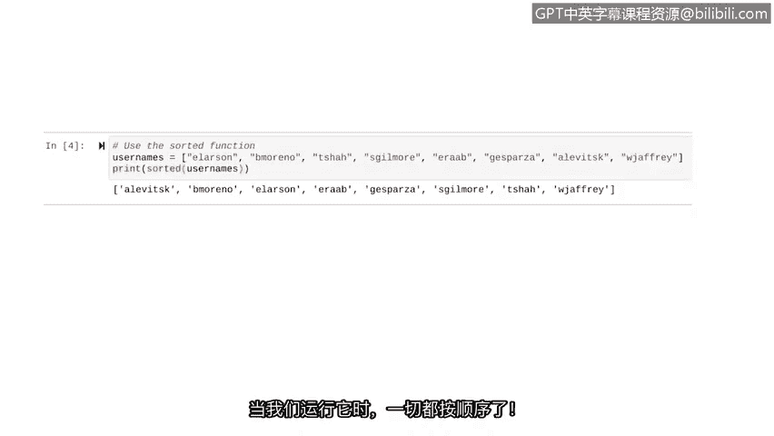
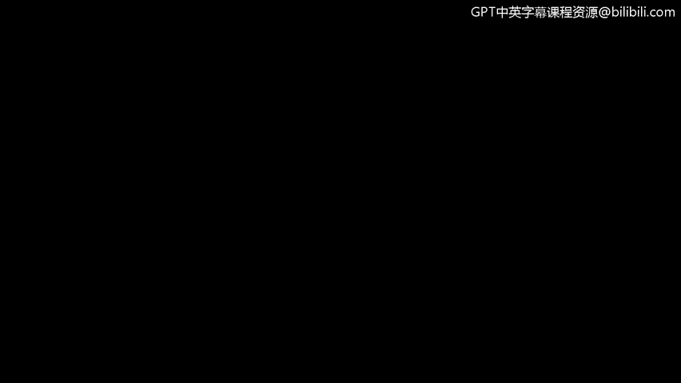

# 谷歌网络安全专业证书第七课：《用Python自动化网络安全任务》（中英字幕，前面分p中字，后面分p英字） - P18：17_探索内置函数.zh - GPT中英字幕课程资源 - BV1Dp4y1G759

Now that we know how to create our own functions。Let's also explore a few of Python's building functions。

As we discussed previously， built in functions are functions that exist within Python and can be called directly。

Our only job is to call them by their name。And we already described a few throughout the course。

 For example， Python， print and type functions。Let's quickly review those two built in functions before learning about new ones。

First。😊，Print outputs a specified object to the screen。

 and then the type function returns the data type of its input。Previously。

 we've been using functions independently from one another。For example。

 we ask Python to print something， or we ask Python to return the data type of something。

As we begin to explore reading functions。We'll often need to use multiple functions together。

We can do this by passing one function into another， as an argument。For example。

 in this line of code。Python first returns the data type of hello as a string。

Then this return value is passed into the print function。

 This means the data type of a string will be printed to the screen。

Print and type are not the only functions youll see used together in this way。In all cases。

 the general syntax is the same。The inner function is processed first。

 and then its return value is passed to the outer function。

Let's consider another aspect of working with building functions。When working with functions。

 you have to understand what their expected inputs and outputs are。

Some functions only expect specific data types and will return a type error if use the wrong one。

Other functions need a specific amount of parameters or return a different data type。

The print function， for example， can take in any data type as its input。

 It can also take in any number of parameters， even once with different data types。

Let's explore the input and output of the print function。We'll enter three arguments。

The first contains a string data。Then a comm used to separate these from the second argument。

This second argument is an integer。Finally， after another commma。

 our third argument is another string。😊，Now， let's run this code。Perfect。These printed out。

 just as expected。The type function also takes in all data types， but it only accepts one parameter。

Let's explore this input and output， too。Our first line of code will first determine the data type of the word security。

 and then。Pass what it returns into a print function。

And the second line of code will do the same thing with the value of 73。2。Now。

 let's run this and see what happens。Python first returns output that tells us that the word security is a string data。

Next， it returns another line of output that tells us that 73。2 is float data。 Now。

 we know what to consider before using a building function。

We have to know exactly how many parameters it requires and what data types they can be。

We also need to know what kind of output it produces。Let's learn a couple of new building functions。

 and think about this。We'll start with Max。The max function returns the largest numeric input passed into it。

It doesn't have a defined number of parameters that it accepts。 Let's explore the max function。

We'll pass three arguments into max in the form of variables。So let's first define those variables。

Will set the value of a to 3。B，2 9。And C to 6。 Then we'll pass these variables into the max function and print them。

Let's run this。It tells us the highest value among those is 9。Now。

 let's study one more building function。The sorted function。

The sorted function sorts the components of a list。

This function can be very useful in a security setting When working with lists。

 we often have to sort them with lists of numbers。 We sort them from the smallest to largest。

 or the other way around。With lists of string data， we might need to sort them alphabetically。

Imagine you have a list that contains usernames in your organization and you wanted to sort them alphabetically。

Let's use Python sorted function for this。Will specify our list through a variable name， username。

In this list， we'll include all of the username we want to sort。Now。

 we'll use the sorted function to sort these names by passing the username variable into it。

And then we'll pass its output into the printed statement so it can be displayed on the screen。

And when we run it， everything is now in order。

These are just a few of the building functions available for your use。As you work more in Python。

 you'll become familiar with others that can help you in your programs。

