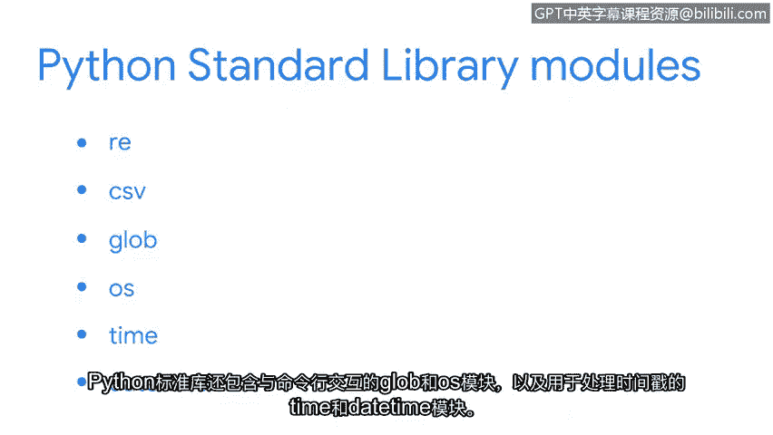

# 谷歌网络安全专业证书第七课：《用Python自动化网络安全任务》（中英字幕，前面分p中字，后面分p英字） - P19：18_模块和库.zh - GPT中英字幕课程资源 - BV1Dp4y1G759

Hello again。Previous， we learn about building functions in Python。

 Building functions come in standard with every version of Python and consist as functions such as print。

 type， max and many more。😊，To access additional previewed functions， you can import a library。

 A library is a collection of modules that provide code users can access in their programs。

All libraries are generally made up of several modules。

 A module is a Python file that contains additional functions， variables。

 classes and any kind of runable code。Think of them as save python files that contain useful functionality。

Moddules may be made up of small and simple lines of code。Or it could be complex and lengthy in size。

Either way， they help save programmers time and make code more readable。Now。

 let's focus specifically on the Python standard library。

 The Python standard library is an extensive collection of usable Python code that often comes package with Python。

One example of a module from the Python standard library is the R module。

This is a useful module for a security analyst when they are tasked with searching for patterns in log files。

Another module is the CSV module。 It allows you to work efficiently with CSV files。

 The Python standard library also contains G and OS modules for interacting with the command line。

 as well as time and date time。For working with timests。

These are just a few of the modules in Python and standard library。

In addition to what's always available through the Python Standard Library。

 you can also download external libraries。A couple of examples are beautiful soup for pars HTMLl website files and numpy for arrays and mathematical computations。

These libraries will assist you as a security analyst in network traffic analysis。

 log file pars and complex math。Overall， Python libraries and modules are useful because they provide pre program functions and variables。

This saves time for the user。I encourage you to explore some of the libraries and modules we discuss here and the ways they might be helpful to you as you work in Python。

